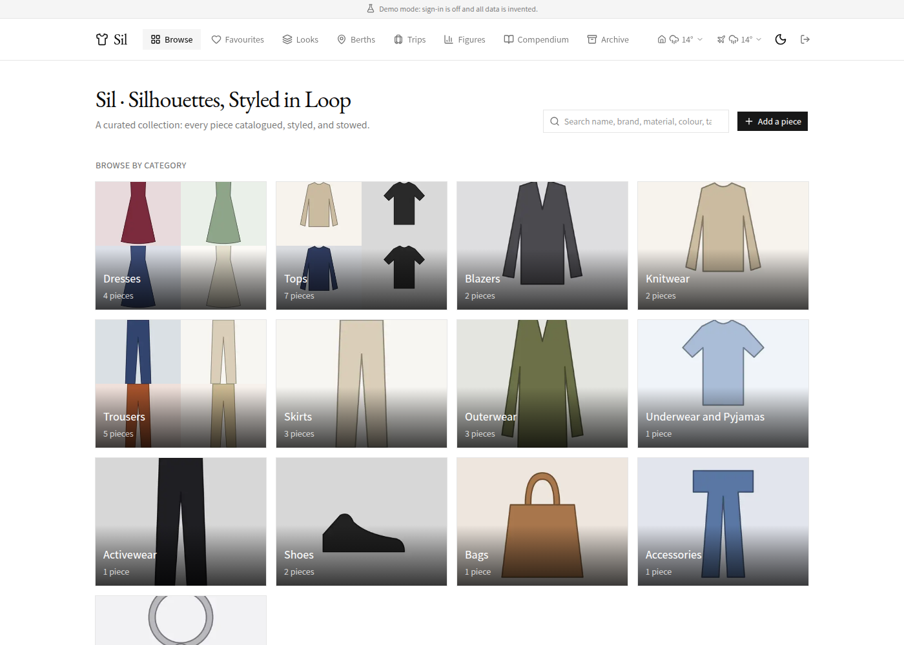
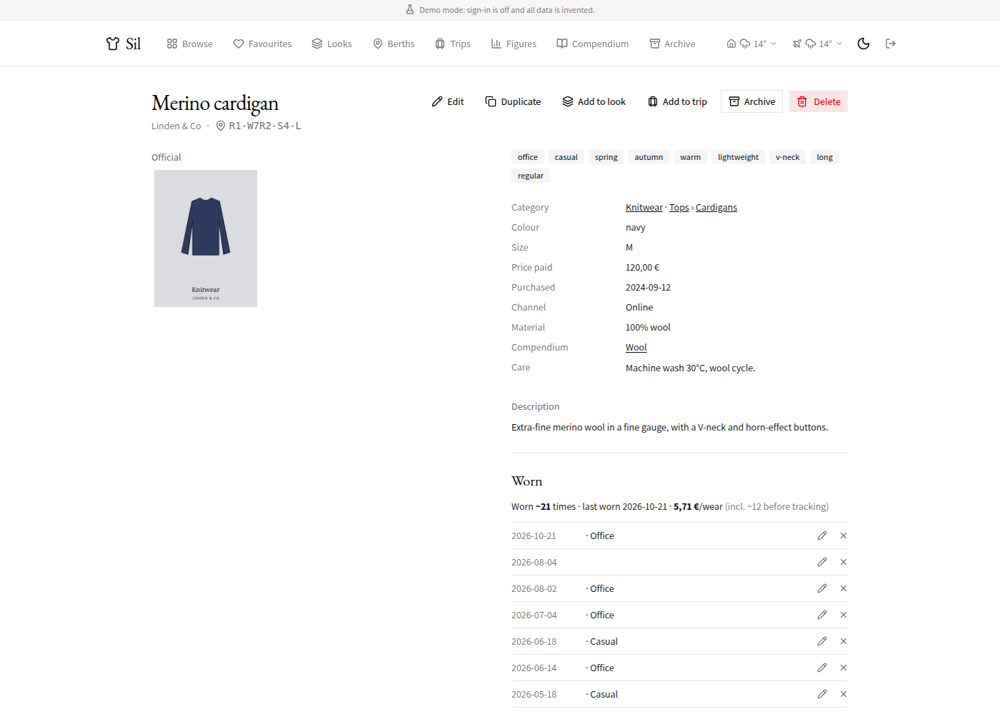

# Sil

> **Silhouettes, Styled in Loop**. A curated collection: every piece catalogued, styled, and stowed.

A personal wardrobe web app. At its centre is a **catalogue** (every piece with
its photos, composition, tags and the berth it is stowed in), and around that:

- **Browse** the wardrobe like a fashion store, filtered by occasion, feel,
  season, care, five style facets, **colour family** and **material**.
- **Looks**: curated sets and styled combinations, and what a piece goes with.
- **Trips**: packing lists built from the wardrobe, planned **by category** or
  **by day**, with a forecast for the destination, a printable sheet and an AI
  planner that proposes rather than decides.
- **Wear tracking**, as individual events rather than a counter, so a wear can
  be corrected.
- **Figures**: a read-only dashboard of composition, spending, wear and value,
  and the gaps in the data.
- **Compendium**: the knowledge the wardrobe runs on. A glossary of the fibres,
  constructions, finishes and cuts it is actually made of, each explained in
  Chinese and linked to the pieces that use it, plus the berth notation.
- **Archive**: a piece that has left the wardrobe is retired, never deleted.

Built with **Next.js 16 (App Router) + React 19 + TypeScript**, **Tailwind CSS 4**
and **shadcn/ui**, and **Drizzle ORM** on **PostgreSQL**. See
[ADR-0001](_governance-local/decisions/ADR-0001-tech-stack.md) for why.





*Screenshots from [demo mode](#demo-mode): every piece, brand and photo is invented.*

## About this repository

This is the public copy of a personal app that runs in production for its owner.

It was built spec-first together with an AI coding agent (Claude): costly decisions are recorded as architecture decision records, each feature has a spec set written before the code, every change starts from a ticket, and the rules are defended by tests. The repository shows that workflow as much as the app itself.

Issue numbers such as "#105" in commit messages, specs and ADRs refer to the private tracker where the app was built; they are kept as historical markers and cannot be opened here.

Personal data has been removed. Names, brands, counts, prices, trips and places in examples are invented.

## Demo mode

Demo mode runs the whole app on your own machine with an invented wardrobe and no Google sign-in, so you can click through every page without any accounts or cloud services. It is the way to try a fresh clone.

Prerequisites: Node 26 (`nvm use` reads it from `.nvmrc`), pnpm, Docker.

```sh
pnpm install                 # install dependencies
cp .env.example .env.local   # DATABASE_URL already points at the Docker database
```

In `.env.local`, set one value and leave the rest as they are:

```sh
DEMO_MODE=1
```

Then start the database, apply the schema, seed the demo data and run the app:

```sh
docker compose up -d         # local Postgres "sil" on port 5434, reachable from this machine only
pnpm db:migrate              # apply the schema
pnpm db:seed-demo            # invent about 30 pieces, 3 looks, 2 trips and their wears
pnpm dev                     # http://localhost:3000
```

On an empty database, `pnpm db:migrate` prints several Postgres `NOTICE` blocks (one per table) such as *trigger "items_touch" for relation "public.items" does not exist, skipping* before *migrations applied successfully!*. They are harmless: one migration drops each update trigger before it creates it, so that it can safely run again, and on a fresh database there is nothing to drop yet.

With `DEMO_MODE=1` every request is treated as the single owner under a fixed demo identity ("Demo", `demo@example.com`), and every page shows a small banner saying that sign-in is off and all data is invented. Without it, the app is gated exactly as before and anyone not signed in is sent to `/signin`.

The seed script refuses to run unless `DEMO_MODE=1` is set and `DATABASE_URL` points at the database named `sil` on `localhost` or `127.0.0.1`. It also refuses if the catalogue already holds anything; `pnpm db:seed-demo --reset` clears every catalogue table (and the local photo files those rows referenced) and seeds afresh. Placeholder photos are generated with `sharp` and written to `public/uploads/`, just as the app stores uploads in development.

AI-assisted import and the AI trip planner call Google Gemini, so they need a `GEMINI_API_KEY` in `.env.local`. They are optional: everything else works without one.

Demo mode must never be used for a real deployment holding personal data. It switches off the only thing that stands between the internet and the wardrobe.

## Local development

Running the app on your own data, with demo mode off, needs the sign-in it is built around: in `.env.local`, an `AUTH_SECRET`, a Google OAuth client (`AUTH_GOOGLE_ID` and `AUTH_GOOGLE_SECRET`, with `http://localhost:3000/api/auth/callback/google` registered as a redirect URI) and your Google address in `OWNER_EMAIL`. `.env.example` explains each one, and [`specs/auth/`](specs/auth/) has the details. Without them every page sends you to `/signin`; to look around, use [demo mode](#demo-mode) instead.

Prerequisites: Node 26 (`nvm use` reads it from `.nvmrc`), pnpm, Docker.

```sh
pnpm install                 # install dependencies
cp .env.example .env.local   # then add the sign-in values above
docker compose up -d         # start local Postgres (port 5434)
pnpm db:migrate              # apply the schema
pnpm dev                     # http://localhost:3000
```

Useful scripts:

| Script | Does |
|:--|:--|
| `pnpm dev` | Run the dev server |
| `pnpm build` | Production build (also typechecks) |
| `pnpm lint` | ESLint |
| `pnpm db:generate` | Generate a migration from schema changes |
| `pnpm db:migrate` | Apply migrations |
| `pnpm db:studio` | Drizzle Studio (browse the DB) |
| `pnpm db:backup` | Snapshot the local data (DB + photos) to `backups/` |
| `pnpm db:restore [path]` | Restore from a backup folder (latest if omitted) |
| `pnpm db:seed-demo [--reset]` | Seed the local `sil` database with invented demo data (needs `DEMO_MODE=1`; see [Demo mode](#demo-mode)) |
| `pnpm changelog` | Regenerate `CHANGELOG.md` with git-cliff |

The database runs in Docker, and photos are stored on the local filesystem under
`public/uploads/` (see [ADR-0002](_governance-local/decisions/ADR-0002-data-layer.md)
and [docs/ARCHITECTURE.md §5](docs/ARCHITECTURE.md#5-photo-storage)).

### Backups (keep a local copy of your data)

In local development your whole wardrobe lives on your machine in two places: the **Postgres database** (in the Docker volume `sil-pgdata`) and the **photo files** (`public/uploads/`). To capture both into a portable snapshot at any time:

```bash
pnpm db:backup                       # → backups/<timestamp>/  (db.dump + uploads/)
pnpm db:restore backups/<timestamp>  # restore a specific snapshot (prompts first)
pnpm db:restore                      # restore the most recent snapshot
```

- **Backups live in `backups/<timestamp>/`** at the repo root. Each folder has `db.dump` (a role-agnostic `pg_dump`, so it also restores into any other Postgres), a copy of `uploads/`, and a `README.txt`.
- The `backups/` folder is **gitignored**: it holds personal data and is never committed. Copy it wherever you keep your backups.
- `db:restore` **replaces** the current data and asks for confirmation first.
- Requires the DB container running (`docker compose up -d`).

## Tests

```bash
pnpm test         # run once
pnpm test:watch   # re-run on change
```

Vitest, no database, in **two tiers under one command**, split by file extension, so a test lands in the right environment by virtue of what it is ([ADR-0015](_governance-local/decisions/ADR-0015-component-test-tier.md)):

| Tier | Files | Environment | Covers |
|:--|:--|:--|:--|
| **unit** | `*.test.ts` | `node` | the pure rules: category roll-up and normalisation, season inference, colour families, the `VAL-ITEM-*` schemas, browse sorting and keyword matching, figure metrics, the berth grammar and ordering, the Compendium matcher, style-facet derivation |
| **components** | `*.test.tsx` | `jsdom` | behaviour that is not a function, above all that **destructive actions ask first** |

The component tier asserts through the accessibility tree (roles and accessible names), so a test breaks when behaviour breaks rather than when a class changes. It deliberately does **not** test layout or gestures: jsdom has no layout engine, so zoom, pan and hit-testing stay manually verified. The whole suite runs in a couple of seconds, so it is cheap to run on every change.

Two conventions keep it honest and keep it from rotting:

- **Tests describe shapes, never inventory.** Filing another hundred pieces must require no test change. Fixtures live in `src/test/`: `makeItem({…overrides})` builds a valid piece so a test states only the field it is about, and `fixtures/catalogue.ts` holds ~15 pieces that each encode an *edge case* (a piece filed in two families, a cross-filed knit, an archived one, one with no price). It grows when a new shape appears, not when a garment is added. Adding a column means updating one default.
- **Tests are named after what they defend**: the spec rule (`describe("VAL-ITEM-02: …")`) or the issue for a regression (`it("#180: scoping to knitwear …")`), so a failure names the behaviour that broke, and a rule with no test is visible.

Data-quality checks against the real catalogue ("15 pieces missing a price") are deliberately **not** tests: they fail for reasons that are not defects. Those belong in a separate audit script.

## How this repository is run

This project follows a deliberately lightweight governance, adapted from a larger documentation-governance regime and scaled to a solo project. The rules live in the repository so every session, human or AI, inherits the same discipline.

- **Decisions** are recorded as **ADRs** in
  [`_governance-local/decisions/`](_governance-local/decisions/). They are frozen
  at acceptance; to change one, write a new ADR that supersedes it. Process and
  template: [`ADR-PROCESS.md`](_governance-local/decisions/ADR-PROCESS.md),
  [`ADR-TEMPLATE.md`](_governance-local/decisions/ADR-TEMPLATE.md).
- **Roadmap.** The phased plan is in [ROADMAP.md](ROADMAP.md).
- **Specs before code.** The system-level [architecture](docs/ARCHITECTURE.md)
  and per-feature specs (`specs/`, added as features are specified) are written
  before a feature is built.
- **Branching:** GitHub Flow. `main` is always deployable; every change goes on a
  short-lived branch, through a squash-merged PR; releases are tags
  ([ADR-0004](_governance-local/decisions/ADR-0004-branching-and-change-flow.md)).
- **Commits:** Conventional Commits enforced by commitlint, with a mandatory scope
  and a mandatory issue-reference footer
  ([ADR-0005](_governance-local/decisions/ADR-0005-commit-conventions.md)). Trivial
  commits reference the standing housekeeping umbrella issue (#2 in the private tracker).
- **Every change references an issue** in the tracker, and each build phase starts with a
  ticket that is agreed before work begins.

### Decision records

| ADR | Decision |
|:--|:--|
| [0000](_governance-local/decisions/ADR-0000-adopt-repository-local-decision-records.md) | Adopt repository-local decision records |
| [0001](_governance-local/decisions/ADR-0001-tech-stack.md) | Next.js + React + TypeScript |
| [0002](_governance-local/decisions/ADR-0002-data-layer.md) | PostgreSQL + Drizzle; tags as an array column |
| [0004](_governance-local/decisions/ADR-0004-branching-and-change-flow.md) | GitHub Flow (main + PR) |
| [0005](_governance-local/decisions/ADR-0005-commit-conventions.md) | Conventional Commits + mandatory scope & issue footer |
| [0006](_governance-local/decisions/ADR-0006-validation-library.md) | Zod for input validation |
| [0007](_governance-local/decisions/ADR-0007-design-system.md) | Design system: Assistant + EB Garamond, sharp edges |
| [0008](_governance-local/decisions/ADR-0008-ai-stack.md) | Google Gemini (AI Studio free tier) via the AI SDK for AI features |
| [0009](_governance-local/decisions/ADR-0009-import-from-saved-html.md) | Import from a saved product page (HTML upload), not server-side URL fetch |
| [0010](_governance-local/decisions/ADR-0010-ai-trip-planner.md) | AI trip packing planner: reuse Gemini, one-shot and human-in-the-loop first |
| [0011](_governance-local/decisions/ADR-0011-add-looks-commit-scope.md) | Add a `looks` commit scope |
| [0012](_governance-local/decisions/ADR-0012-authentication.md) | Single-owner authentication with Auth.js (Google OAuth) |
| [0013](_governance-local/decisions/ADR-0013-product-name-sil.md) | The product is called "Sil" |
| [0014](_governance-local/decisions/ADR-0014-add-test-commit-type.md) | Add a `test` commit type |
| [0015](_governance-local/decisions/ADR-0015-component-test-tier.md) | A component test tier: jsdom + Testing Library, split by file extension |

## Licence

Released under the MIT Licence. See [LICENSE](LICENSE).
