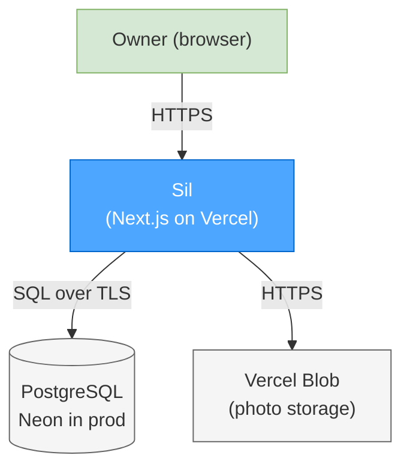
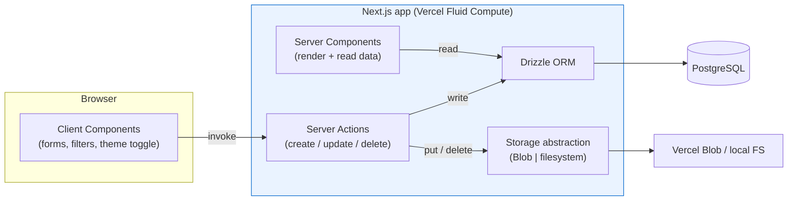
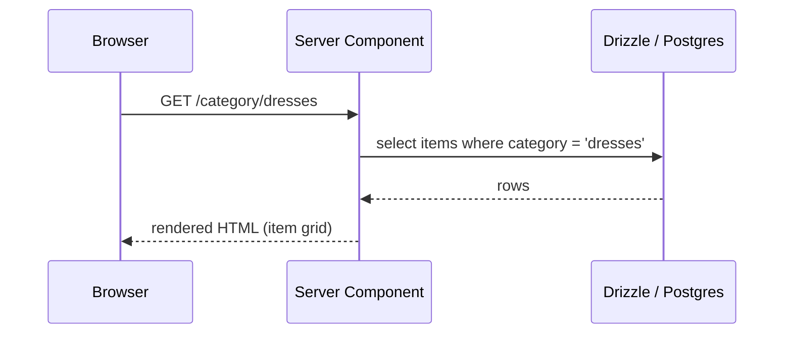
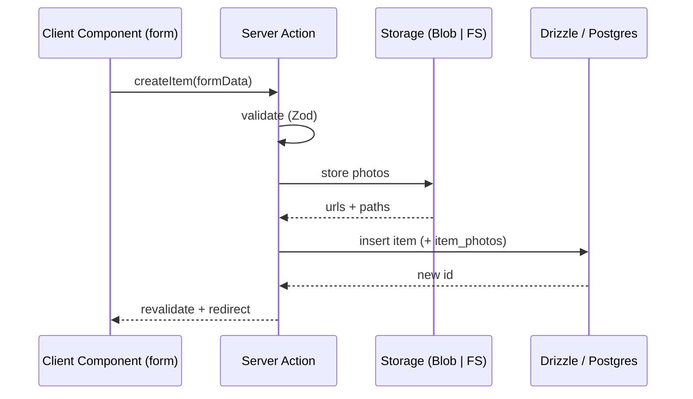
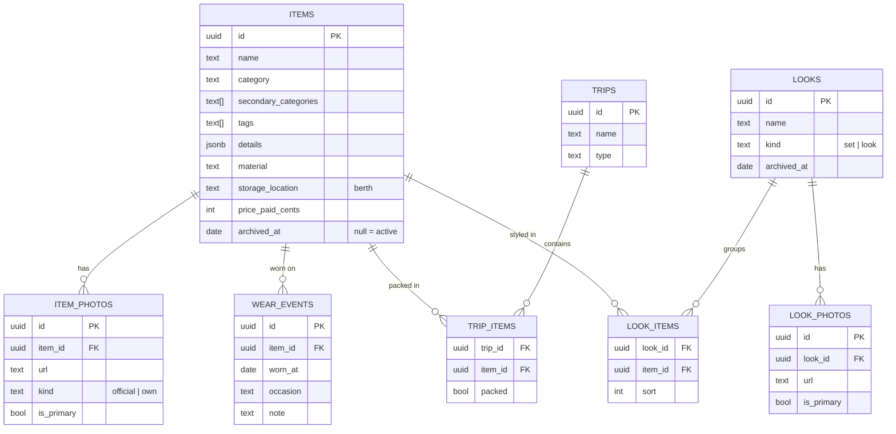

# Sil: Architecture

This is the living, high-level picture of how the app fits together. It is intentionally lean. The *why* behind each choice lives in the frozen ADRs ([`_governance-local/decisions/`](../_governance-local/decisions/)); the *field-level what* of each feature lives in the per-feature specs ([`specs/`](../specs/)). This document cross-links to both rather than repeating them.

> Status: the Catalog, AI-assisted import, browse & filtering, wear tracking, looks, trips (with the AI packing planner), authentication, archive, **Figures** and the **Compendium** are all implemented. What remains deliberately out of scope is listed in §9.

## 1. System context

A single owner uses the app from a browser to catalog clothes, tag them, and build trip packing lists. The app depends on a small set of managed services.



In local development the same app runs against Postgres in Docker and stores photos on the local filesystem: no cloud credentials required (see §6).

## 2. Containers & components



- **Server Components** are the default: they run only on the server, read data directly through Drizzle, and ship no JavaScript for the read path.
- **Client Components** (`"use client"`) cover interactivity only: the add/edit form, the theme toggle, the delete confirmation.
- **Server Actions** handle mutations, called directly from client components; there is no hand-written REST API.
- **Drizzle ORM** is the single data-access layer (`src/db/`).
- **Storage abstraction** (`src/lib/storage.ts`) hides whether a photo goes to Vercel Blob (prod) or the filesystem (dev), and **re-encodes every upload before storing it** (§5).
- **AI-assisted import** (Phase 1.5, shipped): Server Actions (`src/app/items/import-actions.ts`) extract item fields from a product-page **screenshot** or a **saved `.html` page** via Google Gemini through the AI SDK (`generateObject` + Zod), then prefill the add form for review. Nothing is written until the owner saves. Retail pages are fetched by the owner's browser, not our server (they are bot-protected); see ADR-0008 (AI stack) and ADR-0009 (saved-page over URL fetch).
- **Trips & packing** (Phase 3, shipped): routes `/trips` and `/trips/[id]` let the owner create a trip and build a **packing list** from the wardrobe (`trip_items`, packed/not), via Server Actions like the rest of the app. The manual list is the baseline; on top of it an **AI packing planner** (`trip-planner.tsx`, ADR-0010) proposes a plan in one shot for the owner to accept, edit or discard. Nothing is packed without the owner's say. The packing plan has **two views of the same pieces** (#270): **by category** (editable slots with targets, how a suitcase is packed) and **by day**, a plain list per date plus an *Across all days* group for the shoes and the jewellery. A piece may be planned for any number of days and stays **one packed piece**, ticked once on the list: `trip_items` remains the single membership (`packed` lives there), and `trip_item_days` records the plan about it, behind a composite foreign key so un-packing a piece takes its days with it. Both the printable sheet and the Markdown export can group either way. The **packing list** groups by top-level category (a shirt dress under Dresses) and inside each group runs in the trip's own sequence, by the day a piece is first worn (#286, #288); one shared helper does both, so the screen, the printable sheet and the Markdown export cannot disagree. The trips **list** splits into *Coming* and *Past* tabs on today's date, with edit and delete on each card (#290, #292). The trip's `destination` reuses the weather lib (Open-Meteo) for the forecast shown beside the list. See [`specs/trips/`](../specs/trips/) and [`specs/trip-planner/`](../specs/trip-planner/).
- **Batch wear logging** (#320): a wear is stored per piece, but a **day is worn as an outfit**. Two shapes, deliberately different. Where the set already exists as data there is **nothing to select**: `Wore this today` on a Look, `Log this day` on a planned trip day. A trip day opens the dialog on **that day, not today**, because catching up days later is the normal case on the road. Where it does not, a **selection mode** on the packing list and the browse grid gathers pieces ad hoc. It is entered from a button named for the **outcome**, not the mechanism. A quiet `Select` failed on first use: the owner reached for the packed checkbox instead, because a checkbox is the universal "select this", and the mode's own entry point read as nothing in particular. `Log a wear` sits beside `Add from wardrobe` as the list's other action and starts selection with the goal already stated. One dialog writes the same date, occasion and note to every piece **in one transaction**, warns before repeating a date (wearing one piece to the office and then to dinner is real), and offers a single undo for the whole batch. **Logging from a trip also ticks unpacked pieces as packed**: the packing checklist is routinely left half-filled, so `packed = false` usually means *not ticked*, and a wear on the trip is evidence the piece was in the case. That inference runs `false → true` only, only where a trip exists to infer from, and is **named in the toast** rather than done silently; the undo reverts it too. See [`src/lib/batch-wear.ts`](../src/lib/batch-wear.ts).
- **Looks** (Phase 4): routes `/looks` and `/looks/[id]` let the owner group pieces that go together as a **set** (an intrinsic co-ord) or a **look** (a styled combination), via `look_items` and Server Actions. A piece's page shows the Looks it's in and what it "goes with" (curated matches). A Look can be **archived or deleted** (#170); neither ever deletes the pieces inside it, and archiving a *piece* flags its Looks "incomplete" with a reminder rather than cascading. See [`specs/looks/`](../specs/looks/).
- **Figures** (Phase 5, shipped): route `/figures`, a read-only statistics surface covering composition, spending and acquisition, wear & value, data gaps, colour & fabric, care & season. It adds no table and no column: every number is derived from the catalogue, charts are inline SVG and CSS (no charting dependency), and every wear-derived metric states the base it was computed over, because only about a third of the catalogue carries wear data. See [`specs/figures/`](../specs/figures/).
- **Compendium** (Phase 6, shipped): route `/compendium`, a reference area laid out as a documentation site. It has a section tree beside the content, **one route per section** rather than anchors, so an item can link to a particular entry. Two sections: **Materials**, a glossary of 45 entries in four groups (fibres, constructions, finishes and **cuts**, #245), each carrying the term as the trade says it and an explanation in Chinese; and **Berth notation**, which documents a storage code such as `R1-W7R2-S4-L` in five optional-tailed segments (room · unit · place · position · container), the last added when the owner boxed two silk pieces as `R1-W2R3-D1-L-BB` and the grammar could not read it (#277). The catalogue is authoritative there: a code that does not parse is listed anyway and labelled, and it is the grammar that gets extended. Each material group has its own page (`/compendium/fibres` and so on, #265), with `/compendium/materials` as an overview; the entries themselves stayed at `/compendium/materials/<slug>`, because item pages have linked there since the glossary shipped. It adds no table and no column: entries are content in `src/lib/compendium/`, and every piece list, count and code index is derived at read time. Links run both ways: an entry lists its pieces, and an item page names the entries its material matches. See [`specs/compendium/`](../specs/compendium/).
- **Archive** (shipped): a piece that has left the wardrobe (sold, gifted, returned, worn out, lost) is **archived, not deleted**, keeping its photos, wear history and look/trip membership. It is three nullable columns on `items` (`archived_at`, `archive_reason`, `archive_note`) rather than a table, so that **`archived_at IS NULL` is the single definition of "active"**; that predicate is applied inside the shared query helpers (`src/lib/queries.ts`) so no wardrobe view can forget it. **Looks are archivable on the same model** (#170): three matching columns on `looks`, excluded from active look views, with a derived "incomplete" flag when a member piece is archived. Route `/archive` lists archived pieces grouped by category (and retired **looks** below them), and the delete dialog steers towards archiving. Delete still exists, still cascades (links only for looks, never the pieces), and remains the remedy for a wrongly-entered piece. See [`specs/archive/`](../specs/archive/).

## 3. Rendering & data flow

Two representative flows.

**Read: browse the catalog** (no client JS needed for the data)



**Write: add an item with a photo**



Validation rules for each operation are defined as `VAL-*` rules in the feature's functional spec and enforced with Zod inside the Server Action (ADR-0006). Photo uploads travel in the Server Action body, and **two separate limits** apply, both raised to 30 MB in `next.config.ts` for multi-MB phone photos:

- `experimental.serverActions.bodySizeLimit`: the Server Action body (default 1 MB).
- `experimental.proxyClientMaxBodySize`: the body clone Next.js makes to feed `src/proxy.ts` (default **10 MB**).

The proxy limit **bites first**, and on exceeding it Next.js *truncates* the stream with only a `console.warn` rather than erroring, so the action receives half a multipart body and the parser throws `Unexpected end of form`. Both must therefore be raised together and kept in step (#150).

## 4. Data model overview

Items are the heart of the app, with a JSONB `details` column for brand-variable sections, an `item_photos` child table (each photo tagged `official` or `own`), and tags as a Postgres `text[]` column (ADR-0002). Wears are individual events (`wear_events`), not a counter, so a wear can be corrected or removed. Trips have a many-to-many relationship with items via `trip_items`, and **Looks** (curated sets / styled combinations) via `look_items`; a look carries its own photos too (`look_photos`). The authoritative definition is the Drizzle schema ([`src/db/schema.ts`](../src/db/schema.ts)); field-level contracts live in each feature's `30-data-model-spec.md`.



## 5. Photo storage

Photos are large phone images. They are stored as objects and only their URL (and blob pathname, for deletion) is persisted in `item_photos`. The storage abstraction (`src/lib/storage.ts`) selects the backend: Vercel Blob when `BLOB_READ_WRITE_TOKEN` is set, otherwise the local filesystem (`public/uploads/`, git-ignored) for zero-setup dev. See [ADR-0003](../_governance-local/decisions/ADR-0003-photo-storage.md).

> **The switch is a single environment variable, which makes it a trap.** A `BLOB_READ_WRITE_TOKEN` present in `.env.local` silently sends *development* uploads to the *production* store: no warning, no prompt, and the local database then holds prod URLs. Keep the production token out of `.env.local`; any local tooling that genuinely needs one should read it under a **different name**, so that the app cannot pick it up by accident.

**Photos are re-encoded before they are stored.** `putPhoto` runs the upload through `sharp` first: a 7.7 MB phone photo becomes ~300 KB, a 96% saving. This buys faster page loads and lower data transfer, and keeps the library from bloating over years. It costs nothing extra, since it is one `put` either way. **Resolution is deliberately preserved**: only the encoding changes, and that is where nearly all of the saving comes from.

The interactive path encodes **WebP at quality 85**, while bulk/offline work uses **AVIF at quality 85**. The split is measured, not arbitrary: on a 24 MP photo `sharp`'s AVIF took **57 s** at its default effort (unusable while the owner waits, and a timeout risk), and at an effort low enough to be interactive it produced files roughly **twice the size** of WebP. Offline, where encode time is free, AVIF wins on size. The stored library is therefore intentionally mixed.

Re-encoding is fail-safe: the original bytes are kept when the upload is already AVIF/WebP, when re-encoding would not actually be smaller, or if the encoder throws. A failed optimisation must never cost the owner a photo.

## 6. Deployment topology

| Concern | Production | Local development |
|:--|:--|:--|
| Host / runtime | Vercel (Fluid Compute) | `pnpm dev` (Next.js) |
| Database | Neon Postgres (pooled URL) | Postgres in Docker (`docker-compose.yml`, port 5434) |
| Photos | Vercel Blob | Local filesystem (`public/uploads/`) |
| Config | Vercel env vars | `.env.local` |

Environment variables:

| Variable | Purpose |
|:--|:--|
| `DATABASE_URL` | Postgres connection string (Neon pooled URL in prod) |
| `BLOB_READ_WRITE_TOKEN` | Vercel Blob access; absent in dev → filesystem fallback |
| `GOOGLE_GENERATIVE_AI_API_KEY` | Gemini, for AI-assisted import and the trip planner (ADR-0008) |
| `AUTH_SECRET` | Signs/encrypts the Auth.js JWT session (ADR-0012) |
| `AUTH_GOOGLE_ID` / `AUTH_GOOGLE_SECRET` | Google OAuth client credentials |
| `OWNER_EMAIL` | Comma-separated allowlist of permitted verified emails; empty ⇒ nobody is admitted |
| `DEMO_MODE` | `1` switches sign-in off for a local demo with invented data (§8); never set in production |

The same Drizzle schema and migrations run in both environments; only the connection string and storage backend differ.

**Production credentials are not kept in the working tree.** `DATABASE_URL` in `.env.local` always points at the local container. If a local tool ever genuinely needs the production connection string, hold it under a deliberately different name, so that no dev server or migration command can be pointed at production by accident.

**Backups are local and explicit.** `pnpm db:backup` (`scripts/db-backup.sh`) writes a timestamped folder under `backups/` (git-ignored) holding a role-agnostic `pg_dump` of the database and a copy of `public/uploads/`; `pnpm db:restore` (`scripts/db-restore.sh`) replaces the current database and photo files from such a folder, after asking for confirmation. Because the dump carries no owner or privileges, the same file also restores into a Neon database.

## 7. Directory layout & conventions

```
src/
  app/               # Next.js App Router
    page.tsx          # home: category grid + live counts
    items/            # new, [id] (detail), [id]/edit, actions.ts (Server Actions)
    category/[slug]/  # category grid
    browse/           # filter + search across the wardrobe
    looks/ trips/     # looks & sets; trips and packing
    berths/           # browse by storage location
    figures/          # the statistics tab
    compendium/       # the reference area: materials glossary + berth notation
    archive/          # retired pieces and looks
    signin/ api/auth/ # Auth.js (the only public surface)
  components/         # shared components (item-form, item-card, photo-gallery,
                      #   photo-viewer, markdown, wear-log, …)
    ui/               # shadcn/ui primitives (generated)
    figures/          # chart primitives + the figures sidebar
    compendium/       # section tree + the "in this wardrobe" piece strip
  db/                # Drizzle schema + client
  lib/               # queries, validation (Zod), storage, format, domain constants
    compendium/       # the glossary entries, the matcher, the berth grammar
  test/              # factories, the fixture catalogue, setup-dom.ts (no production code)
drizzle/             # generated SQL migrations
scripts/             # operational scripts: backup, restore, and the demo seed
docs/                # this architecture doc
specs/               # per-feature spec sets
_governance-local/   # ADRs (decisions/), process, template
```

Conventions:

- Server Components by default; add `"use client"` only where interactivity requires it.
- Mutations go through Server Actions (`src/app/items/actions.ts`).
- Domain vocabulary (categories, tag groups, photo kinds) lives once in [`src/lib/categories.ts`](../src/lib/categories.ts).
- **Category membership has one rule, in one place**: `categoryMatcher(slug)` (#180). A piece is in a category when the slug *or any descendant* is its primary `category` **or** one of its `secondary_categories`. Counting on the primary alone drops cross-filed pieces; adding sibling categories double-counts the ones filed in two (culottes are trousers *and* skirts). Being pure, the same rule serves client components and server queries.
- **What is stored is normalised, not just what is read**: `normaliseSecondaries(primary, ticked)` (#206). A ticked child brings its ancestors into `secondary_categories`, and the primary is never repeated there. Ancestors are recomputed from the *current* primary on every save, so re-filing a piece drops the parent it no longer belongs to instead of leaving it stale. Running in the Zod transform means the rule holds however the form behaves.
- **Behaviour worth having twice is extracted, not reimplemented**: the full-screen photo viewer is one component (`photo-viewer.tsx`) shared by the item gallery and a look's photos, so the pan-clamping (#127) and visual-viewport sizing (#131) fixes hold in both. The wrap rule behind it is a pure function (`stepIndex`, `src/lib/photos.ts`) precisely so it can be tested without a DOM.
- **Ids that reach the DOM must be stable across the server/client boundary**: `React.useId()`, never a module counter. dnd-kit's auto-generated `DndContext` id is per-instance and mismatched on hydration when a page mounts several (#209).
- **Derived, never stored.** Three features now compute what they show on every render rather than persisting it: a berth's category summary (#219), every Compendium count and piece list (#213), and the codes-in-use index. The rule is that a stored summary is wrong the moment a piece moves and nobody notices; a derived one cannot go stale. It costs a whole-catalogue scan over a few hundred rows, which is cheaper than the page it renders.
- **`description` describes the garment; `notes` describe wearing it.** The distinction is load-bearing, not stylistic: notes talk about *other* clothes ("to wear under the cropped blazers"), so anything deriving facts about a piece reads `name` and `description` and never `notes` (#229).
- **Text matching is shared and defensive.** `containsToken` (`src/lib/compendium/match.ts`) is the one place token boundaries and the negation guard live; the Compendium matcher and the facet derivation both use it. Boundaries stop `rib` finding *ribbon* and `silk` finding *silky*; the negation guard stops "no rib welt" claiming a rib.

  Two more guards were added once the prose grew cross-references (#243, #245). A Markdown link to **another piece** is removed entirely before matching (a cardigan was being filed under *Jacquard* for a sentence about a coat), while a link to the **Compendium** keeps its label and loses its address, because the label describes this piece and the URL merely contains the word. And where one word names two things, the token says which is meant: *metallic* matches `metallic yarn` and `metallised`, never the bare adjective, so a leather belt's "metallic finish" is not a fibre.

  A third pair arrived when the Denim entry was found listing **8 pieces of which 4 were not denim** (#267). Denim is the only glossary term that is also a colour and a wardrobe category, so it appears constantly in sentences about other clothes: "it sits with charcoal, ivory and denim", "dressed down with denim", "over a jersey vest". A **companion guard** (*goes with*, *sits with*, *worn with*, and the layering prepositions *under* / *over* / *beneath*) and a **look-alike guard** (*a denim look*, *denim-inspired*) now skip those. `styled with` is deliberately excluded: in retail copy it means *features*, and it was suppressing a true A-line.

  What still has no guard is a **comparison**: "on a single jersey the same edge would roll", said of a piece that is not jersey. There is no syntactic marker for it, so it stays a known limitation and the remedy is to link it or reword it. It has caught four sentences so far, each written by the assistant rather than by a retailer.

  **The browse filters follow the same rule from the other side.** Colour families (`colorMatchSpec`) and now fibres (`materialPatterns`, #263) hand SQL the *same* vocabulary the app uses in memory rather than a second copy of it, because SQL cannot call the matcher per row. The material filter drops the negation and link guards knowingly: it reads the composition label, where across 112 strings there are zero negations and zero links.
- `notes` and `description` are Markdown, rendered sanitized (`react-markdown` + `rehype-sanitize`).
- Links styled as buttons use `buttonVariants()` (Base UI has no `asChild`).
- Data-backed pages are marked `dynamic = "force-dynamic"` so they always reflect the current data.
- **A database blip must not become a dead page** (#308). Production once served 500s on every page reading `items` with `relation "items" does not exist`, on a database where the table was present and readable throughout; it cleared by itself. The app cannot prevent that (Neon's pooler ignores a client-side `search_path` and Drizzle refuses to qualify to `public`, #307), so it survives it instead. Every read in `queries.ts` goes through `withRetry`, which tries **once** more for connection-class faults only and rethrows constraint, syntax and permission errors untouched; a retry that swallows a real error turns a loud bug into an intermittent one. Above that, `error.tsx` keeps the navigation and says plainly that nothing is lost, and `global-error.tsx` catches a failure in the root layout with no imports at all: anything it imported could be the reason the layout crashed.

## 8. Cross-cutting concerns

- **Authentication** (ADR-0012, `specs/auth/`): the whole app is gated. Auth.js (NextAuth v5) with **Google**, **JWT sessions** (no session/user tables), and a fail-closed **single-owner allowlist** on the verified email (`OWNER_EMAIL`). The Next.js 16 **proxy** (`src/proxy.ts`) redirects anonymous requests to `/signin`; that check is optimistic, so Server Components and Actions remain the source of truth via `auth()`. Public surface: `/signin`, `/api/auth/*`, uploaded photos and framework assets. **Demo mode** (`DEMO_MODE=1`, for local demos only, never a real deployment) bypasses the gate: the proxy lets every request through without consulting Auth.js, `currentUser()` in `src/auth.ts` returns a fixed invented owner ("Demo", `demo@example.com`), and the layout shows a banner on every page. The decision itself is a pure function in `src/lib/demo.ts`, unit-tested on both sides; with the switch unset the gate fails closed exactly as before. `pnpm db:seed-demo` (`scripts/seed-demo.mjs`) fills the local `sil` database with an invented wardrobe and refuses any other database.
- **Configuration** via environment variables (§6); `.env.local` is git-ignored, `.env.example` is the tracked template.
- **Validation** happens in Server Actions against the `VAL-*` rules, using Zod (ADR-0006).
- **Error / feedback** surfaces to the user via toasts (`sonner`).
- **Type safety** end-to-end: Drizzle's inferred row types flow into the app.
- **Tests** (`pnpm test`, vitest, ADR-0014 for the `test` commit type) run in **two tiers, one command**, split by file extension so a test lands in the right environment by virtue of what it is (ADR-0015):

  | Tier | Files | Environment | Covers |
  |:--|:--|:--|:--|
  | **unit** | `*.test.ts` | `node` | pure rules: category roll-up, season inference, colour families, the `VAL-ITEM-*` schemas, browse sorting, figure metrics |
  | **components** | `*.test.tsx` | `jsdom` | behaviour that is not a function: above all that **destructive actions ask first**, such as removing a look photo (`VAL-LOOK-13`) or deleting a logged wear (`VAL-WEAR-09`), and that a control does what its label says (the category setter, #206) |

  The component tier exists because the guarantees most worth protecting are destructive: a missing confirmation loses data, and a manual browser pass proves only that it worked once. It asserts through the accessibility tree (roles and accessible names), so a test breaks when behaviour breaks rather than when a class changes, and doubles as a check that controls stay reachable without a mouse. **It deliberately does not test layout or gestures**: jsdom has no layout engine and reports zero geometry, so zoom, pan and hit-testing stay manually verified (ADR-0015). Server actions, `next/image` and `next/navigation` are mocked: the tier tests components, not the database.

  The unit tier runs with no DOM and no database, so it stays under a second; the DOM tier adds a couple more. Fixtures live in `src/test/` and describe **shapes, not inventory**: a factory builds a valid piece so a test states only the field it is about, and the fixture catalogue holds pieces that each encode an edge case. Filing garments therefore costs no test maintenance. Tests are named after the spec rule they defend (`VAL-ITEM-02`) or the issue whose regression they pin (`#180`). A query-layer tier against a disposable Postgres is planned alongside the statistics dashboard.

## 9. Non-goals (future phases)

Deliberately out of scope, each to be specified when reached:

- **Multi-user / sharing.** Authentication itself has shipped (ADR-0012, §8), but it admits exactly one owner; there are no accounts, roles or sharing, and adding a second permitted person is an `OWNER_EMAIL` entry, not a schema change.
- **Return-window reminders** (driven by `return_by`).
- **Semantic / natural-language search** over the wardrobe, which needs embeddings (pgvector), not SQL; keyword search is today's baseline (`specs/browse/`).

Since shipped, and no longer future: **trips & packing** (`specs/trips/`, `specs/trip-planner/`), **looks/outfits** (`specs/looks/`), **wear tracking** (`specs/wear-tracking/`), **browse & filtering** (`specs/browse/`), **authentication** (`specs/auth/`), **archive** (`specs/archive/`), **Figures** (`specs/figures/`) and the **Compendium** (`specs/compendium/`).

## 10. Related documents

- Decisions: [`_governance-local/decisions/`](../_governance-local/decisions/) (ADR-0001 stack · 0002 data · 0003 storage · 0004 branching · 0005 commits · 0006 validation · 0007 design system · 0008 AI stack · 0009 saved-page import · 0010 AI trip planner · 0011 looks commit scope · 0012 authentication · 0013 product name · 0014 `test` commit type · 0015 component test tier).
- Feature specs: [`specs/`](../specs/) (catalog, ai-import, browse, berths, wear-tracking, looks, trips, trip-planner, weather, auth, archive, figures and compendium).
- The phased plan: [`ROADMAP.md`](../ROADMAP.md).
- How the repo is run: [`README.md`](../README.md).
