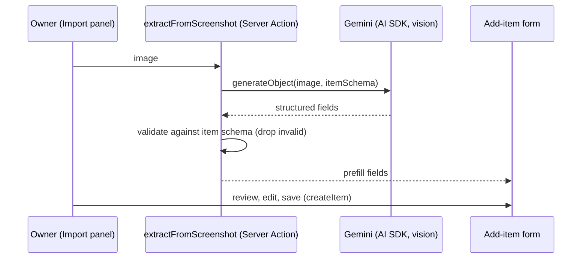
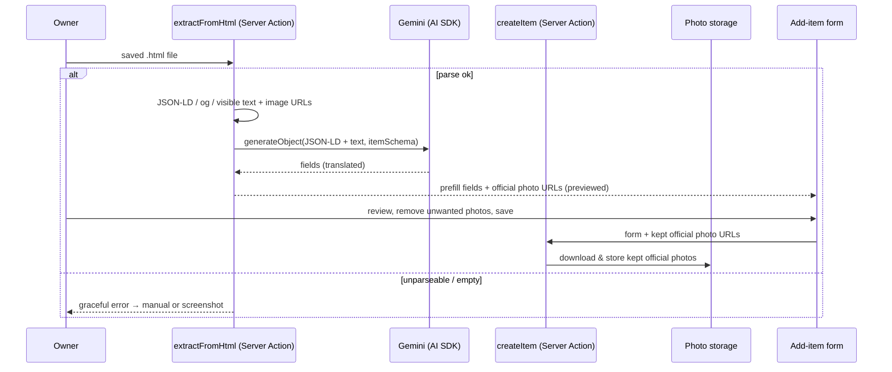

# AI-Assisted Import: Interface Specification

- **Spec ID:** `SPEC-AIIMPORT-INT`
- **Part of set:** `SPEC-SET-AI-IMPORT` v0.2.0
- **Traceability:** `SPEC-AIIMPORT-FUNC` (rules §4); [docs/ARCHITECTURE.md](../../docs/ARCHITECTURE.md); issue #11

## 1. Purpose and scope

Defines how import is exposed and wired: the UI on the add-item page, the Server Actions that run extraction, and the AI SDK integration. Extraction runs **server-side only** (the API key never reaches the client).

## 2. UI

On `/items/new`, above the form, an **Import panel** with two tabs:

- **From a screenshot**: a file input. On select, it calls `extractFromScreenshot`.
- **From a saved page**: a file input for an `.html` file. On select, it calls `extractFromHtml` (Phase 1.5b).

While a call is in flight, the panel shows a pending state. On success the returned fields **prefill the `ItemForm`** (the existing add form, made controllable so imported values can seed it); for the saved-page mode, the returned official image URLs are shown as **removable previews** the form carries as a hidden field. The owner then edits and submits through the normal `createItem`. On failure, a toast explains and the form stays ready for manual entry.

## 3. Server Actions

| Action | Input | Result |
|:--|:--|:--|
| `extractFromScreenshot(formData)` | an image file | `{ ok, values }` (validated subset of item input) or `{ ok: false, error }` |
| `extractFromHtml(formData)` | a saved `.html` file | `{ ok, values, officialPhotoUrls }` or `{ ok: false, error }` (Phase 1.5b) |

Both run on the server, call the model via the AI SDK, validate the result against the item Zod schema, and return only clean, safe fields. They **do not write to the database**: persistence happens later via `createItem` after review (`VAL-IMPORT-01`). The official images are **downloaded and stored by `createItem` at save time** (from the URLs the owner keeps), not by `extractFromHtml`.

## 4. AI SDK integration

- Use the **AI SDK** (`ai`) `generateObject` with a **Zod schema** derived from the item input schema (ADR-0006), so the model returns typed, validated structured output.
- Provider **`@ai-sdk/google`** (Gemini, AI Studio free tier), model id in a single swappable constant (ADR-0008). Confirm the current AI SDK API with the `vercel:ai-sdk` skill before coding.
- Screenshot mode passes the image as a vision input. Saved-page mode parses the uploaded HTML server-side and passes the **JSON-LD `Product`** block, the page **title**, the **meta description** (`og:description`), and the stripped **visible text** to the model. Forwarding the title + meta description matters because some retailers (e.g. Tommy Bahama) render product copy **client-side**, so it lives in `<meta>` / JSON rather than the saved page's visible text. The official image URLs are parsed deterministically (JSON-LD `image[]` → `og:image`) and returned for the form to preview.

  Content behind **collapsed accordions** (Product Details, Materials & Care) is generally not in the saved HTML, so the import UI advises expanding sections before *Save As*.
- Env: `GOOGLE_GENERATIVE_AI_API_KEY` (or `GEMINI_API_KEY`), server-only (ADR-0008); no page fetch and no scraping credential (ADR-0009).

## 5. Flows

### 5.1 Screenshot import: `STEP-IMPORT-SS-*`

- `STEP-IMPORT-SS-01` select image → `02` extract → `03` validate → `04` prefill → `05` owner reviews & saves.

### 5.2 Saved-page import: `STEP-IMPORT-HTML-*` (Phase 1.5b)

- `STEP-IMPORT-HTML-01` upload file → `02` parse (JSON-LD/og/text + image URLs) → `03` extract & translate → `04` validate → `05` prefill + preview photos → `06` owner reviews & saves → `07` `createItem` downloads kept official photos.

## 6. UI states

- **Idle / pending / success / error** on the import panel; success populates the form, error shows a toast and leaves manual entry available.
- The form remains fully usable without ever importing: import is additive.
