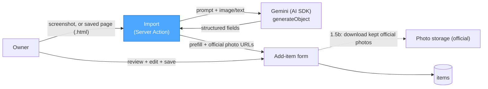

# AI-Assisted Import: Specification Set

> **Set ID:** `SPEC-SET-AI-IMPORT` · **Version:** `0.2.0` · **Status:** DRAFT · **Owner:** nnworkspace

This is Phase 1.5, built on the Catalog MVP (#8). It lets the owner import an item from a brand's product page, by **screenshot** or by uploading a **saved copy of the page (`.html`)**, extracting the fields (and, for the saved page, the official photos) with an LLM and **prefilling the add-item form for review**. It reuses the Catalog item model unchanged; nothing is saved until the owner confirms.

## 1. Purpose

Typing a garment's details from a product page is tedious. This feature does the tedious part: given a screenshot or a saved copy of the page, it extracts name, brand, colour, size, prices, material, care, description, and any brand-specific sections, and drops them into the add-item form for the owner to review, correct, and save.

## 2. Scope

| In scope | Out of scope |
|:--|:--|
| **1.5a**: screenshot/photo → extract fields → prefill the add-item form | Saving an item without owner review (always human-in-the-loop) |
| **1.5b**: saved product page (`.html`) → parse + extract fields **and** download the official photos → prefill | Bulk import (many items at once) |
| Structured extraction validated against the item schema before prefill | Non-clothing items / general object recognition |
| Graceful fallback to manual entry when extraction fails | Editing the extraction model's behaviour from the UI |

**Build order: 1.5a first** (screenshot/vision is site-agnostic and robust), then **1.5b**. Note **1.5b imports a *saved* page, not a fetched URL**: probing showed retail pages (e.g. Theory) are Cloudflare-protected, blocking both our server-side fetch and Gemini's `urlContext` tool, so the owner saves the page in their own browser (*Save As → Webpage, Complete*) and uploads it. See **ADR-0009**.

## 3. Traceability

| Anchor | Reference |
|:--|:--|
| Stack | [ADR-0001](../../_governance-local/decisions/ADR-0001-tech-stack.md) |
| Data layer / item model | [ADR-0002](../../_governance-local/decisions/ADR-0002-data-layer.md) |
| Validation (Zod) | [ADR-0006](../../_governance-local/decisions/ADR-0006-validation-library.md) |
| Photo storage | [ADR-0003](../../_governance-local/decisions/ADR-0003-photo-storage.md) |
| AI stack (Gemini via the AI SDK) | [ADR-0008](../../_governance-local/decisions/ADR-0008-ai-stack.md) |
| 1.5b via saved HTML (not URL fetch) | [ADR-0009](../../_governance-local/decisions/ADR-0009-import-from-saved-html.md) |
| Catalog **data model** (columns it fills) | [`SPEC-CATALOG-DATA`](../catalog/30-data-model-spec.md) |
| Catalog form it prefills | [specs/catalog/](../catalog/) |
| This feature's issue | #11 |

## 4. Specification artefacts

| ID | File | Role |
|:--|:--|:--|
| `SPEC-AIIMPORT-FUNC` | [10-functional-spec.md](10-functional-spec.md) | Operations, extraction contract, validation rules |
| `SPEC-AIIMPORT-INT` | [20-interface-spec.md](20-interface-spec.md) | UI, Server Actions, AI SDK integration, flows |
| | [manifest.yaml](manifest.yaml) | Inventory |

No `30-data-model` of its own: the feature persists nothing new. It writes through the **Catalog data model** ([`SPEC-CATALOG-DATA`](../catalog/30-data-model-spec.md), implemented in [`src/db/schema.ts`](../../src/db/schema.ts)): each extracted field maps to an `items` column (`name`, `brand`, `product_code`, `color`, `size`, `list_price_cents`, `price_paid_cents`, `currency`, `material`, `care`, `description`, `details`), the source page URL to `product_url` (defined there as the *hook for AI import*), and downloaded official photos to `item_photos` with `kind = official`.

## 5. Feature context

For 1.5b the official photos are **downloaded at save time** (by `createItem`, from the URLs the owner keeps), not at import time, so an abandoned draft leaves no orphaned blobs.

## 6. How to read this set

1. **This README** for scope and context.
2. **[10-functional-spec.md](10-functional-spec.md)**: what it extracts and the rules (`VAL-IMPORT-*`).
3. **[20-interface-spec.md](20-interface-spec.md)**: the UI, Server Actions, and the AI SDK wiring.
