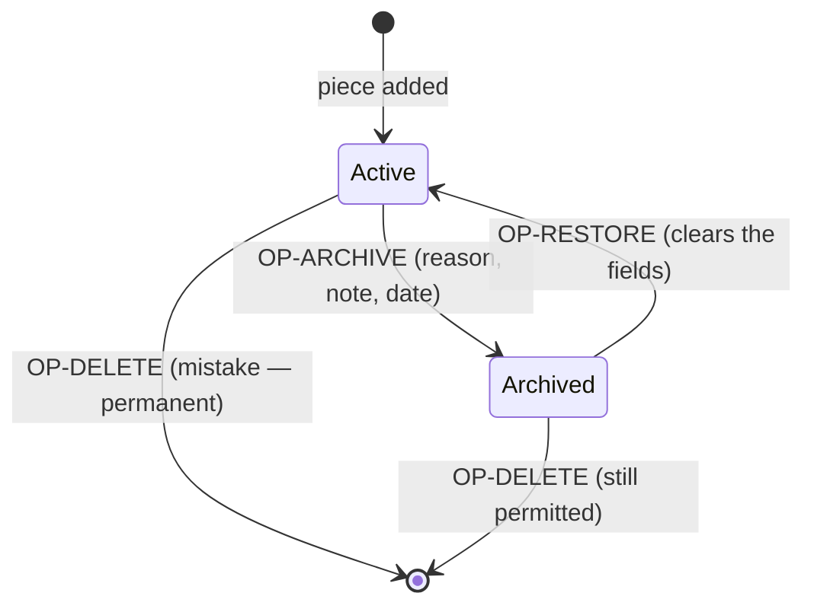

# Archive — Functional Specification

- **Spec ID:** `SPEC-ARCHIVE-FUNC`
- **Part of set:** `SPEC-SET-ARCHIVE` v0.1.0
- **Traceability:** [ADR-0002](../../_governance-local/decisions/ADR-0002-data-layer.md), [ADR-0006](../../_governance-local/decisions/ADR-0006-validation-library.md); extends [`SPEC-CATALOG-DATA`](../catalog/30-data-model-spec.md); issue #142 (the look interaction in §7 is #170, owned by [`SPEC-SET-LOOKS`](../looks/))

## 1. Purpose and scope

Defines what it means for a piece to be **archived**, the operations that archive and restore it, how archived pieces disappear from the active wardrobe without losing anything, and the rules all of that obeys. Archiving is a **statement about the real world** — the piece was sold, gifted, lost or worn out — so it records a **reason**, an optional **note**, and the **date** it left.

## 2. Archive vs delete

These answer different questions and must not be conflated:

| | **Archive** | **Delete** |
|:--|:--|:--|
| Means | "I owned this; it's gone now." | "This piece was never real — I entered it wrongly." |
| Keeps | Everything: photos, wear history, look and trip membership, prices | Nothing — the row and its photos are removed |
| Reversible | Yes (`OP-RESTORE`) | No |
| Appears in the active wardrobe | No | n/a |
| Appears in `/archive` | Yes | No |

Delete is unchanged by this feature. Because deleting a genuinely-owned piece silently destroys history, the delete confirmation gains a **nudge** towards archiving (`OP-ARCHIVE-INSTEAD`).

## 3. Actors

The **owner** — the single authenticated user (see [`specs/auth/`](../auth/)). No other actor archives or restores.

## 4. Operations

### 4.1 Archive a piece — `OP-ARCHIVE`

- **Purpose:** record that a piece has left the wardrobe, keeping its history.
- **Trigger:** the owner uses the **Archive** control on the item detail page.
- **Behaviour:** opens a modal capturing a **reason** (required, from §5), an optional **note**, and the **date it left** (required, defaults to today). On save the piece becomes archived: it disappears from every active-wardrobe view (§6) and appears under `/archive`. Nothing else about the piece changes — photos, wears, prices, tags, and look/trip membership are all retained.
- **Outcome:** the piece is archived, with the reason and date recorded and visible on its page.

### 4.2 Restore a piece — `OP-RESTORE`

- **Purpose:** undo an archive — it was a mistake, or the piece came back.
- **Trigger:** the owner uses **Restore** on an archived piece (its detail page or the archive list).
- **Behaviour:** clears the archive fields; the piece returns to the active wardrobe exactly as it was. The previous reason/note/date are **not** kept as history (`VAL-ARCHIVE-07`).
- **Outcome:** the piece is active again and leaves `/archive`.

### 4.3 Review the archive — `OP-VIEW-ARCHIVE`

- **Purpose:** see everything that has left the wardrobe.
- **Trigger:** the owner opens **Archive** from the navigation.
- **Behaviour:** lists archived pieces **grouped by category**, each group in the owner's chosen **grid** or **list** view. Each entry shows the piece, its **reason** and the **date archived**. Empty state when nothing is archived.
- **Outcome:** a readable record of what left, and when and why.

### 4.4 Open an archived piece — `OP-EDIT-ARCHIVED`

- **Purpose:** archived pieces stay fully usable as records.
- **Trigger:** the owner clicks an entry in the archive.
- **Behaviour:** the normal item detail page opens, **clearly marked as archived** (with reason and date), and remains **fully editable** — including its wear log, so a forgotten wear can still be recorded. The Archive action is replaced by **Restore**.
- **Outcome:** archived pieces are first-class records, not read-only tombstones.

### 4.5 Offer archive instead of delete — `OP-ARCHIVE-INSTEAD`

- **Purpose:** stop the owner destroying real history by reaching for Delete.
- **Trigger:** the owner opens the delete confirmation on an **active** piece.
- **Behaviour:** the dialog explains that deleting is for wrongly-entered pieces and offers **Archive instead**, which closes it and opens the archive modal. Delete remains available and unchanged.
- **Outcome:** the destructive path stays possible but is no longer the obvious one.

## 5. Reason vocabulary

A small, closed set, recorded in the **past tense** because it states what happened:

| Value | Meaning |
|:--|:--|
| `sold` | sold on (resale, second-hand) |
| `gifted` | given away |
| `returned` | returned to the retailer — the catalogue already tracks `return_by` / `return_policy`, so returns are a real path out |
| `worn-out` | worn out, damaged beyond use, discarded |
| `lost` | lost or stolen |
| `other` | anything else; the note carries the detail |

Free-form detail belongs in the **note**, never in the reason — the closed set keeps the archive groupable and countable later.

## 6. The active wardrobe

**A piece is active exactly when it has no archive date.** This single definition governs every read that means "my wardrobe":

- the home category grid **and its counts**
- `/browse` and the category pages, under every facet, filter, search and sort
- the **wardrobe picker** used to build looks and trip packing lists
- any aggregate presented as the wardrobe

Archived pieces remain reachable **only** through `/archive`, a direct link, or an existing look/trip that already references them (§7).

## 7. Existing references to an archived piece

Looks and trips keep their reference — a look records what was actually worn, and rewriting the past is worse than showing an absence. The piece is **shown but visibly marked as archived**, so the owner understands why it can no longer be worn. It is not silently removed, and it is not offered when *adding* pieces to a look or trip.

**Looks reminder (#170).** Archiving a piece **never** un-links it from its looks and **never** auto-archives a look (a look may have several members; cascading would throw away good curation). Instead, archiving a piece that belongs to one or more **active** looks shows a **reminder** listing those looks (with links), so the owner can edit or retire them by choice. Each such look becomes **incomplete** — it contains a retired piece and can no longer be fully worn — and is flagged as such; see [`SPEC-LOOKS-FUNC`](../looks/10-functional-spec.md) §2.10–§2.12, §3. Conversely, a look that is itself archived drops out of each member's "In these Looks" (the link disappears from the active view; the membership row survives for restore).

## 8. Business validation rules

| Rule ID | Validation |
|:--|:--|
| `VAL-ARCHIVE-01` | The archive **date is required**, must be a valid date, and **may not be in the future** — a piece cannot have left tomorrow. |
| `VAL-ARCHIVE-02` | The **reason is required** and must be one of the §5 vocabulary; unknown values are rejected. |
| `VAL-ARCHIVE-03` | The **note is optional**, trimmed, ≤ 255 characters; blank ⇒ stored as none. |
| `VAL-ARCHIVE-04` | A piece is **active if and only if** it has no archive date; every active-wardrobe read applies this (§6). |
| `VAL-ARCHIVE-05` | Archiving **never destroys data**: photos, wear events, tags, prices and look/trip membership are untouched. |
| `VAL-ARCHIVE-06` | Archiving an already-archived piece is **not an error** — it updates the reason/note/date rather than creating a second record. |
| `VAL-ARCHIVE-07` | Restoring **clears all three archive fields together**; no partial state (a reason without a date, or vice versa) may exist. |
| `VAL-ARCHIVE-08` | An archived piece is **not selectable** when adding pieces to a look or a trip, though existing references remain (§7). |
| `VAL-ARCHIVE-09` | **Delete is unaffected** — still permitted on any piece, archived or not, and still permanent. |
| `VAL-ARCHIVE-10` | Values are validated (Zod, ADR-0006) before any write; invalid input is rejected with a message, never silently dropped. |

## 9. States

## 10. Out of scope / future

- **Bulk** archive/restore, and automatic archiving (by age or disuse).
- **Disposal analytics** — what gets sold vs worn out, resale value recovered, cost-per-wear at the point of archiving. The data is deliberately captured to make this possible later.
- A **history** of archive events (a piece archived, restored and archived again keeps only the latest); if that is ever wanted it becomes an events table, not more columns.
