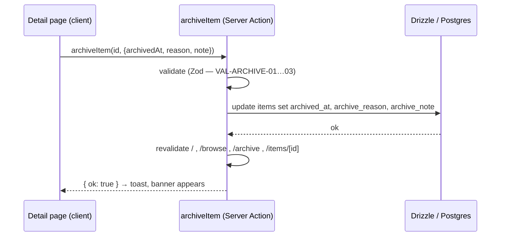

# Archive — Interface Specification

- **Spec ID:** `SPEC-ARCHIVE-INT`
- **Part of set:** `SPEC-SET-ARCHIVE` v0.1.0
- **Traceability:** `SPEC-ARCHIVE-FUNC` (rules §8); [ADR-0001](../../_governance-local/decisions/ADR-0001-tech-stack.md), [ADR-0006](../../_governance-local/decisions/ADR-0006-validation-library.md); issue #142

## 1. Purpose and scope

Defines how archiving is exposed and wired: the archive control and its modal, the `/archive` route and its two views, the navigation entry, and — most importantly — the **one condition** that keeps archived pieces out of every active-wardrobe read.

## 2. The active-wardrobe condition

The whole feature hinges on one predicate, so it is defined **once** and reused:

```ts
// src/lib/queries.ts
const notArchived = () => isNull(items.archivedAt);
```

It is applied **inside the shared helpers**, not at each call site, so a new page cannot forget it. Concretely:

| Function | Archived pieces | Why |
|:--|:--|:--|
| `getBrowseItems` | **excluded** | browse, and the **wardrobe picker** for looks/trips, which reads through it |
| `getItemsByCategory` | **excluded** | category grids |
| `getItemsDirectlyInCategory` | **excluded** | the "not categorised" bucket |
| `getCategoryCounts` | **excluded** | home counts must match what the grids show |
| `getCategoryCovers` | **excluded** | a sold piece should not illustrate a category |
| `getGoesWith` | **excluded** | it suggests what to wear; suggesting a gone piece is noise |
| `getItemWithPhotos` | **included** | the detail page must open for archived pieces (`OP-EDIT-ARCHIVED`) |
| `getLookWithItems`, `getTripWithItems`, `getLooksForItem` | **included** | existing references are history and stay visible, marked (`SPEC-ARCHIVE-FUNC` §7) |
| `getLookOptions`, `getTripOptions` | n/a | these list looks/trips, not items |
| **new** `getArchivedItems` | **only archived** | the `/archive` view |

Because `getBrowseItems` backs the picker used by `src/app/looks/[id]`, `src/app/trips/[id]`, `plan-actions.ts` and `planner-actions.ts`, excluding there satisfies `VAL-ARCHIVE-08` in one place.

## 3. Server Actions

In `src/app/items/archive-actions.ts` (mutations only; ADR-0006 validation):

| Action | Signature | Behaviour |
|:--|:--|:--|
| `archiveItem` | `(itemId, { archivedAt, reason, note })` | validates against `VAL-ARCHIVE-01…03`, sets the three columns, revalidates `/`, `/browse`, `/archive`, `/items/[id]`; idempotent per `VAL-ARCHIVE-06` |
| `restoreItem` | `(itemId)` | clears all three columns together (`VAL-ARCHIVE-07`), revalidates the same paths |

Both return a typed result (`{ ok } | { ok: false, error }`) so the modal can show a message rather than throwing, mirroring `quickLogWear`.

## 4. The archive modal

Reached from **Archive** on the item detail page, beside Edit / Duplicate / Delete. Uses the shared `Dialog`, and mirrors the wear modal (#129) so the interaction is already familiar:

| Field | Control | Default |
|:--|:--|:--|
| **Date it left** | date input, `max` = today (`VAL-ARCHIVE-01`) | **today** (viewer's local date) |
| **Reason** | select over the §5 vocabulary, required (`VAL-ARCHIVE-02`) | none selected — the owner must choose |
| **Note** | text input, ≤ 255 (`VAL-ARCHIVE-03`) | empty |
| Actions | **Archive** · Cancel | — |

Reason is deliberately *not* pre-selected: an unconsidered default (e.g. "sold") would silently falsify the record.

## 5. The item detail page

- **Active piece:** an **Archive** action alongside Edit / Duplicate / Delete.
- **Archived piece:** a clear banner — *"Archived · sold · 12 March 2024"* plus the note — and the Archive action is replaced by **Restore**. Everything else (fields, photos, wear log) stays **editable**, per `OP-EDIT-ARCHIVED`.
- The header already wraps its action row on phones (#127), so the extra control needs no new layout work.

## 6. The delete dialog

`DeleteItemButton` keeps its confirmation, with added steering (`OP-ARCHIVE-INSTEAD`): the copy explains that deleting is for wrongly-entered pieces, and an **Archive instead** button closes the dialog and opens the archive modal. **Delete** stays exactly as it is.

## 7. Route `/archive`

A Server Component listing archived pieces **grouped by category**, in the catalogue's category order, each group headed by its label and count. Within a group, pieces are ordered by **archive date, newest first** — the archive reads as a timeline of what left.

| Param | Meaning | Example |
|:--|:--|:--|
| `view` | `grid` (default) or `list`; unknown values ignored, per the browse convention (`VAL-BROWSE-02`) | `?view=list` |

- **Grid view** reuses the existing `ItemCard`, minus the favourite/log-a-wear overlays (both meaningless for a piece that is gone), with the reason and date beneath.
- **List view** is a compact row per piece — thumbnail, name, brand, size, **reason**, **date archived** — better for scanning a long history.
- The toggle is URL-reflected so a chosen view survives refresh and sharing.
- **Empty state:** "Nothing archived yet", explaining that archiving retires a piece without losing its history.

> The grid/list toggle is written generically enough to be reused on browse later; that reuse is **not** in this scope (issue #142 suggests it as a second increment).

## 8. Navigation

An **Archive** entry (lucide `Archive` icon) is added to the single `NAV` array in `SiteHeader`, so it appears in the **desktop bar** and the **mobile drawer** automatically (#133). The owner asked that it not crowd the mobile layout — the mobile *bar* carries no nav entries at all, so the drawer placement satisfies that at no cost.

Active state follows the existing `pathname.startsWith(href)` rule; `/archive` needs no special handling (unlike Favourites, which shares a route with Browse).

## 9. Rendering & flow



Reads stay Server Components; the only client JavaScript is the modal and the view toggle.
