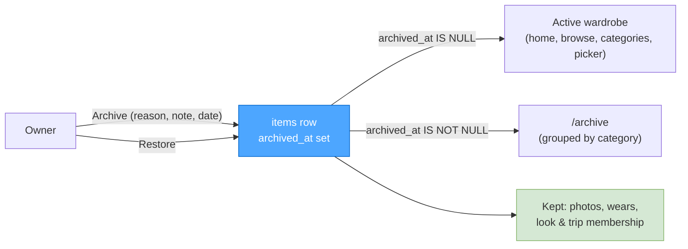

# Archive — Specification Set

> **Set ID:** `SPEC-SET-ARCHIVE` · **Version:** `0.1.0` · **Status:** DRAFT · **Owner:** nnworkspace

A piece that has **left the wardrobe** — sold, gifted, lost, worn out — is **archived**, not deleted. Archiving records what happened in real life and **keeps the piece and its whole history**; the piece simply stops counting as part of the active wardrobe. Deleting stays what it always was: the remedy for a piece entered by mistake.

## 1. Purpose

The catalogue is a record of a real wardrobe over time, and things leave it. Until now the only way to remove a piece was **delete**, which destroys its photos, wear history and look/trip membership — so using it for a piece that was genuinely owned quietly erases the past. Archive draws the line the owner actually cares about: *"this is gone"* is a different event from *"this was never real"*. Because archived pieces keep their wear events and price, they also make retrospective questions answerable — a piece marked `sold` with its cost-per-wear tells you whether it earned its keep.

## 2. Scope

| In scope | Out of scope |
|:--|:--|
| Archiving any item with a **reason**, an optional **note** and a **date** (default today) | A separate archive table — archiving happens once per piece, so it is three columns on `items` |
| **Restoring** an archived piece back to the active wardrobe | Bulk archive / restore |
| Excluding archived pieces from **every active-wardrobe read** (home counts, browse, categories, the looks/trips picker) | Automatic archiving (e.g. by age or disuse) |
| An **Archive** view listing archived pieces **grouped by category**, in **grid or list** view | Analytics over disposals (what you sell most, resale value) — a later idea |
| Viewing and **editing** an archived piece exactly as before | Changing what **delete** does; it stays available and unchanged |
| Steering delete → archive in the delete confirmation dialog | Multi-user/ownership transfer semantics |

## 3. Traceability

| Anchor | Reference |
|:--|:--|
| Stack | [ADR-0001](../../_governance-local/decisions/ADR-0001-tech-stack.md) |
| Data layer / item model | [ADR-0002](../../_governance-local/decisions/ADR-0002-data-layer.md) |
| Validation (Zod) | [ADR-0006](../../_governance-local/decisions/ADR-0006-validation-library.md) |
| The item model it extends | [`SPEC-CATALOG-DATA`](../catalog/30-data-model-spec.md) |
| Wear history that archived pieces keep | [`specs/wear-tracking/`](../wear-tracking/) |
| Views that must exclude archived pieces | [`specs/browse/`](../browse/), [`specs/looks/`](../looks/), [`specs/trips/`](../trips/) |
| This feature's issue | #142 |

## 4. Specification artefacts

| ID | File | Role |
|:--|:--|:--|
| `SPEC-ARCHIVE-FUNC` | [10-functional-spec.md](10-functional-spec.md) | Operations, the reason vocabulary, `VAL-ARCHIVE-*` rules |
| `SPEC-ARCHIVE-INT` | [20-interface-spec.md](20-interface-spec.md) | Route, archive modal, grid/list view, the shared active-wardrobe condition |
| `SPEC-ARCHIVE-DATA` | [30-data-model-spec.md](30-data-model-spec.md) | The three `items` columns and the migration |
| — | [manifest.yaml](manifest.yaml) | Inventory |

## 5. Feature context

## 6. How to read this set

1. **This README** for the distinction between archive and delete, and the scope.
2. **[10-functional-spec.md](10-functional-spec.md)** — the operations and the rules (`VAL-ARCHIVE-*`).
3. **[20-interface-spec.md](20-interface-spec.md)** — the route, the modal, the views, and the one condition that keeps archived pieces out of the active wardrobe.
4. **[30-data-model-spec.md](30-data-model-spec.md)** — the columns and the migration.
