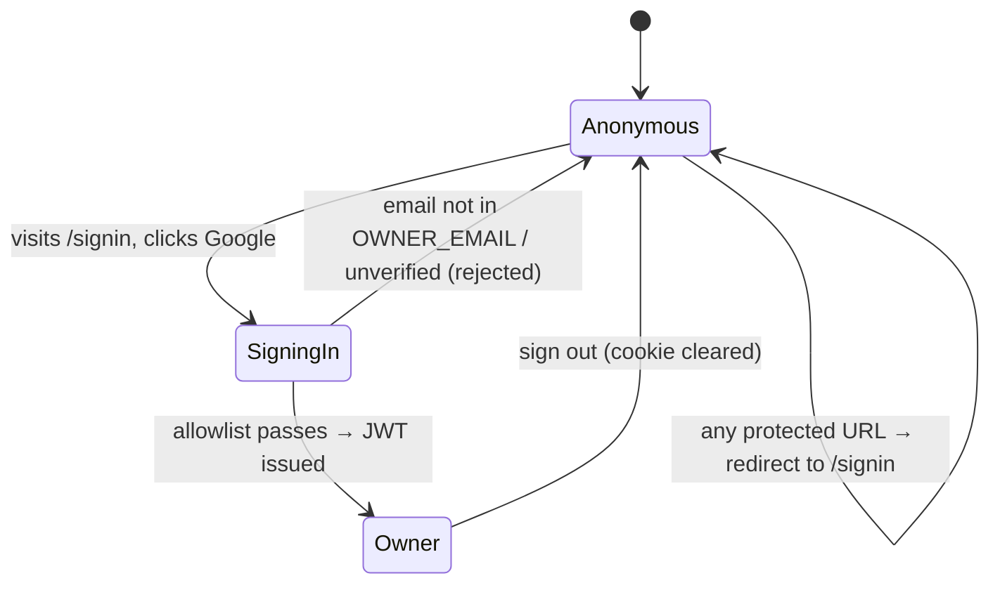

# Authentication — Functional Specification

- **Spec ID:** `SPEC-AUTH-FUNC`
- **Part of set:** `SPEC-SET-AUTH` v0.1.0
- **Traceability:** [ADR-0012](../../_governance-local/decisions/ADR-0012-authentication.md); issue #119

Defines *what* the gate does: the operations the owner can perform, the rule that decides who is admitted, and what the gate does to every other request. The *how* (routes, config, env) is in [20-interface-spec.md](20-interface-spec.md).

## 1. Actors

- **Owner** — the single permitted person, identified by a Google account whose verified email is listed in `OWNER_EMAIL`. (More than one email may be listed; each is an owner.)
- **Visitor** — anyone else. A visitor may reach `/signin` and attempt a Google sign-in, but is never admitted to the app.

## 2. Operations

| ID | Operation | Description |
|:--|:--|:--|
| `OP-AUTH-SIGNIN` | **Sign in** | From `/signin`, the owner starts Google OAuth. On success and passing the allowlist, a JWT session cookie is issued and they land on `/` (or the originally requested URL). |
| `OP-AUTH-SIGNOUT` | **Sign out** | From the header control, the session cookie is cleared and the owner is returned to `/signin`. |
| `OP-AUTH-GATE` | **Gate a request** | Every request outside the public set is checked; anonymous requests are redirected to `/signin` carrying the original URL as `callbackUrl`. |

## 3. Rules

| ID | Rule |
|:--|:--|
| `VAL-AUTH-ALLOWLIST` | A Google account is admitted **only if** its email is present (case-insensitive) in `OWNER_EMAIL` **and** the account's `email_verified` is true. Both conditions are required. |
| `VAL-AUTH-FAILCLOSED` | If `OWNER_EMAIL` is empty or unset, **no one** is admitted. The allowlist fails closed — a misconfiguration locks the owner out rather than opening the app. |
| `VAL-AUTH-CASEFOLD` | Emails are compared lowercased and trimmed on both sides, so `Owner@Gmail.com` and `owner@gmail.com` match. |
| `VAL-AUTH-VERIFIED` | An unverified Google email is rejected even if listed, so a listed address can't be impersonated by an account that never proved ownership of it. |
| `VAL-AUTH-PUBLIC` | Only the sign-in page, the Auth.js API routes, uploaded photos, and framework internals are public (see the proxy matcher in the interface spec). Everything else requires a session. |
| `VAL-AUTH-SERVER-TRUTH` | The proxy check is **optimistic** only (it runs at the edge without a DB). Server components and server actions remain the source of truth and re-check the session via `auth()`. |

## 4. States & transitions

## 5. What is deliberately absent

- **No sign-up.** Identity is delegated to Google; the app never creates accounts or stores passwords.
- **No roles or per-item permissions.** There is one owner; everything they can reach, they may use.
- **No account management UI.** Changing who may sign in is an `OWNER_EMAIL` edit (plus a Google test-user entry while the OAuth app is unpublished), not an in-app operation.
- **No persisted session/user data.** Sessions are JWTs in a cookie; nothing is written to the database.
