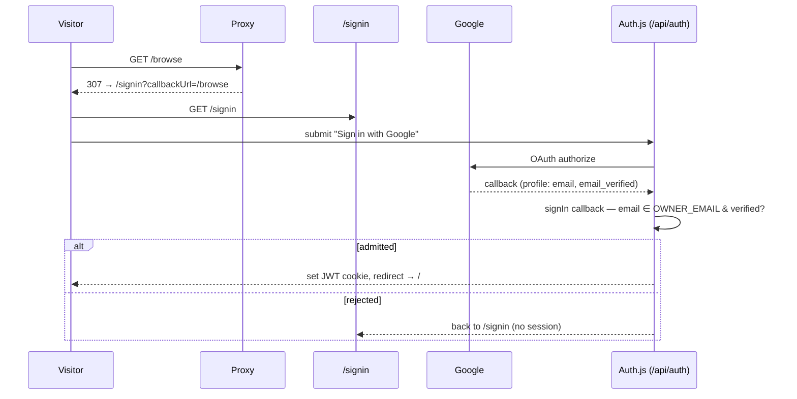

# Authentication — Interface Specification

- **Spec ID:** `SPEC-AUTH-INT`
- **Part of set:** `SPEC-SET-AUTH` v0.1.0
- **Traceability:** [ADR-0012](../../_governance-local/decisions/ADR-0012-authentication.md); issue #119

Defines *how* the gate is wired: the routes, the proxy matcher, the Auth.js configuration, the sign-in/sign-out UI, and the environment contract. The rules it enforces are in [10-functional-spec.md](10-functional-spec.md).

## 1. Library & session strategy

- **Auth.js / NextAuth v5** (`next-auth@5`), Google provider only.
- **JWT sessions** (`session.strategy = "jwt"`) — Edge-compatible, no database adapter, no session/user/account tables.

## 2. Routes & files

| Path / file | Role |
|:--|:--|
| `src/auth.ts` | The NextAuth config — providers, session strategy, `pages.signIn`, and the `signIn` / `authorized` callbacks. Exports `handlers`, `auth`, `signIn`, `signOut`. |
| `src/app/api/auth/[...nextauth]/route.ts` | Mounts `handlers` as `GET` / `POST` — the OAuth start, callback, providers, and session endpoints under `/api/auth/*`. |
| `src/proxy.ts` | The Next.js 16 **proxy** (formerly middleware). `export { auth as proxy }` runs the `authorized` callback on matched requests and redirects anonymous ones to `/signin`. |
| `src/app/signin/page.tsx` | The only public page. A single **"Sign in with Google"** button in an inline server-action form calling `signIn("google", { redirectTo: "/" })`. `dynamic = "force-dynamic"`. |
| `src/app/auth-actions.ts` | `"use server"` — `signOutAction()` calls `signOut({ redirectTo: "/signin" })`. |
| `src/app/layout.tsx` | Reads the session with `await auth()`; renders the header (nav + sign-out) **only** when signed in, so `/signin` shows bare. |
| `src/components/site-header.tsx` | Adds a sign-out button (`LogOut` icon, `title` shows the owner email) that submits `signOutAction`. |

## 3. Proxy matcher

The proxy runs on everything **except** the public set:

```
matcher: ["/((?!api/auth|signin|_next/static|_next/image|uploads|favicon.ico).*)"]
```

| Excluded | Why |
|:--|:--|
| `api/auth/*` | The OAuth handshake itself must be reachable while anonymous. |
| `signin` | The sign-in page must render to anonymous visitors. |
| `_next/static`, `_next/image`, `favicon.ico` | Framework assets; no session needed. |
| `uploads` | Item photos are served by unguessable URL; excluding them keeps `` loads off the auth path. |

An anonymous request to any other path returns a **307** to `/signin?callbackUrl=<original>`.

## 4. Auth.js config (`src/auth.ts`)

```ts
const OWNERS = (process.env.OWNER_EMAIL ?? "")
  .split(",").map((e) => e.trim().toLowerCase()).filter(Boolean);

export const { handlers, auth, signIn, signOut } = NextAuth({
  providers: [Google],
  session: { strategy: "jwt" },
  pages: { signIn: "/signin" },
  callbacks: {
    signIn({ profile }) {
      const email = profile?.email?.toLowerCase();
      return Boolean(email && profile?.email_verified && OWNERS.includes(email));
    },
    authorized({ auth }) {
      return Boolean(auth?.user);
    },
  },
});
```

- `signIn` enforces `VAL-AUTH-ALLOWLIST` / `VAL-AUTH-VERIFIED` / `VAL-AUTH-CASEFOLD` / `VAL-AUTH-FAILCLOSED` (empty `OWNERS` ⇒ nobody matches).
- `authorized` is what the proxy consults: a request is allowed iff it carries a session user.

## 5. Environment contract

| Var | Purpose | Where |
|:--|:--|:--|
| `AUTH_SECRET` | Signs/encrypts the JWT. Generate with `openssl rand -base64 32`. | `.env.local` (dev), Vercel (prod) |
| `AUTH_GOOGLE_ID` | Google OAuth client ID. | same |
| `AUTH_GOOGLE_SECRET` | Google OAuth client secret. | same |
| `OWNER_EMAIL` | Comma-separated allowlist of permitted verified emails. | same |

Documented (names only, no values) in `.env.example`. The Google OAuth client must register both callback URLs: `http://localhost:3000/api/auth/callback/google` (dev) and `https://<prod-domain>/api/auth/callback/google` (prod). While the OAuth consent screen is unpublished ("Testing"), each permitted email must also be added as a Google **test user**.

## 6. Flows



## 7. Verification

- **Build:** `pnpm build` compiles and the proxy is registered (build output lists `ƒ Proxy (Middleware)`).
- **Gate (runtime):** anonymous `GET /` and `GET /browse` return **307 → /signin**; `GET /signin` returns **200** with the Google button; `GET /api/auth/providers` returns the `google` provider — all confirmed against the dev server.
- **Login:** a real Google sign-in must be driven in a browser (OAuth can't be curled); an allowlisted test user is admitted, a non-listed account is rejected.
