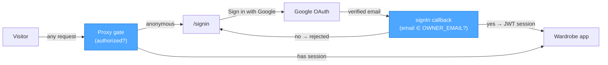

# Authentication — Specification Set

> **Set ID:** `SPEC-SET-AUTH` · **Version:** `0.1.0` · **Status:** DRAFT · **Owner:** nnworkspace

The wardrobe app had **no authentication** — fine on `localhost`, but the app is about to be deployed, and a public URL would expose the entire wardrobe, including the owner's own photos, to anyone who found it. This set defines a **single-owner gate**: a real OAuth login via **Auth.js (NextAuth v5)** with **Google**, admitting only the owner and redirecting everyone else to a sign-in page.

## 1. Purpose

Make the deployed app private to its owner with the least machinery. There is exactly one user, so there is no sign-up, no roles, and no user table — just "is the person in front of the app the owner, proven by a Google login?" Identity comes from Google (verified email); the app keeps a tiny **allowlist** (`OWNER_EMAIL`) and admits a session only if the signed-in email is on it. Everything else in the app is unchanged; this is a gate wrapped around what already exists.

## 2. Scope

| In scope | Out of scope |
|:--|:--|
| Google OAuth sign-in via Auth.js (NextAuth v5) | Email/password, magic links, other providers |
| **JWT sessions** (no session/user/account tables) | A database session adapter |
| **Single-owner allowlist** on the verified email (`OWNER_EMAIL`, comma-separated, **fail-closed**) | Sign-up, roles, permissions, multi-tenant users |
| App-wide gating via the **Next.js 16 proxy** → redirect anonymous requests to `/signin` | Per-resource authorization (there is one owner) |
| A bare public `/signin` page; a sign-out control in the header | Account settings / profile management |
| Config via env: `AUTH_SECRET`, `AUTH_GOOGLE_ID`, `AUTH_GOOGLE_SECRET`, `OWNER_EMAIL` | Storing any user data we don't already have |

Adding a second permitted person later is a new entry in `OWNER_EMAIL` (and a Google test user) — **not** a schema change.

## 3. Traceability

| Anchor | Reference |
|:--|:--|
| Stack | [ADR-0001](../../_governance-local/decisions/ADR-0001-tech-stack.md) |
| Authentication decision (provider, JWT, allowlist, proxy gate) | [ADR-0012](../../_governance-local/decisions/ADR-0012-authentication.md) |
| Next.js 16 proxy (formerly middleware) | `node_modules/next/dist/docs/01-app/01-getting-started/16-proxy.md` |
| This feature's issue | #119 |

## 4. Specification artefacts

| ID | File | Role |
|:--|:--|:--|
| `SPEC-AUTH-FUNC` | [10-functional-spec.md](10-functional-spec.md) | Sign-in / sign-out operations, allowlist rule, gate semantics |
| `SPEC-AUTH-INT` | [20-interface-spec.md](20-interface-spec.md) | Routes, proxy matcher, Auth.js config, UI, flows, env |
| — | [manifest.yaml](manifest.yaml) | Inventory |

No `30-data-model` of its own — the feature persists **nothing**. Sessions are JWTs in a cookie; identity lives at Google; the allowlist is an env var. No columns or tables are added.

## 5. Feature context

## 6. How to read this set

1. **This README** for scope and the trust model.
2. **[10-functional-spec.md](10-functional-spec.md)** — the operations and the allowlist / gate rules (`VAL-AUTH-*`).
3. **[20-interface-spec.md](20-interface-spec.md)** — the routes, the proxy matcher, the Auth.js config, and the env contract.
