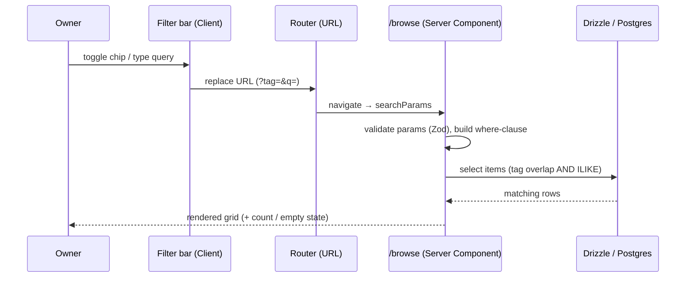

# Browse, Filter & Search — Interface Specification

- **Spec ID:** `SPEC-BROWSE-INT`
- **Part of set:** `SPEC-SET-BROWSE` v0.5.0
- **Traceability:** `SPEC-BROWSE-FUNC` (rules §4); [docs/ARCHITECTURE.md](../../docs/ARCHITECTURE.md); issues #38, #105, #109

## 1. Purpose and scope

Defines how browse is exposed and wired: the `/browse` route, the URL contract that holds the filter/search state, the server-side Drizzle query, and the filter-bar UI. Reads run in a **Server Component**; the only client JavaScript is the filter bar updating the URL.

## 2. Route & URL contract

A new route **`/browse`** (Server Component). All state lives in the query string so it is shareable and survives refresh (`VAL-BROWSE-06`):

| Param | Meaning | Example |
|:--|:--|:--|
| `tag` | Selected tag(s); repeated. Grouped server-side by their `TAG_GROUPS` kind. Unknown values ignored (`VAL-BROWSE-02`). | `?tag=summer&tag=office` |
| `color` | Selected colour **family** key(s); repeated (#105). Unknown values ignored. | `?color=blue&color=black` |
| `material` | Selected **fibre** key(s); repeated (#263). Compendium slugs. Unknown values ignored. | `?material=linen&material=silk` |
| `q` | Keyword query; trimmed, length-bounded. | `?q=linen` |
| `sort` | Single sort option key (#109); absent ⇒ newest added. Unknown values ignored. | `?sort=price-desc` |
| `favorite` | Favourites only (#135); on when the value is `1` (or `true`), absent otherwise. The **Favourites** nav entry deep-links to it. | `?favorite=1` |

`/browse` with no params ⇒ the full wardrobe. The route reads `searchParams`, validates them (Zod, ADR-0006), builds the query, and renders the grid. **The same panel + URL contract is reused on the category pages** (`/category/[slug]`), where the filters are AND-combined with the category's roll-up (#105); the category's `?sub=` selection is preserved and is not touched by the filter panel's "clear all".

## 3. Server-side query

Built with Drizzle against `items`; all conditions AND-combined:

- **Tags** — group the honoured `tag` values by kind; for each group with a selection, add an array-overlap condition `items.tags && ARRAY[…selected…]` (OR within the group); multiple groups ⇒ multiple overlap conditions AND-ed (across groups) — matching `VAL-BROWSE-03`.
- **Colour families** (#105) — `color` is free text with dozens of near-duplicate values, so the filter offers ~12 base **families** (black, white, grey, blue, green, red, pink, yellow, orange, purple, neutral, multi), each a set of keywords (`src/lib/colors.ts`). For the selected families, add `OR(ILIKE(color, %kw%) …)` over all their keywords; multiple families ⇒ OR within the colour condition.
- **Material** (#263) — `material` is free text too, and worse: 174 distinct strings, in three languages, with percentages. The filter offers the Compendium's **fibre** entries, each already carrying every spelling a label might print (`polyamide` / `polyamid` / `nylon`). For the selected fibres, add `OR(material ~* '\y(tok|tok)\y' …)`; multiple fibres ⇒ OR within the condition, because "linen or cotton" is what a wardrobe question sounds like.

  Two things are deliberate. The vocabulary is **derived from `COMPENDIUM_ENTRIES`, never restated** — the same discipline `VAL-BROWSE-17` imposes on colour, and for the same reason: a second hand-written list would drift silently, and a filter that quietly stopped finding lyocell looks exactly like a wardrobe with no lyocell in it. And it offers **fibres only**: *poplin* and *denim* answer "how was it woven", which is a different question, and a control meaning both would mean neither.

  The Compendium's matcher also skips negated mentions and strips Markdown links; SQL can express neither. That loss is safe **here and only here**, because this reads the composition label, where across all 354 material strings there are zero negations and zero links. If `material` ever starts carrying sentences, this needs re-measuring rather than trusting.

- **Keyword** — for a non-empty `q`, `OR(ILIKE(name, %q%), ILIKE(brand, %q%), ILIKE(material, %q%), ILIKE(color, %q%), ILIKE(array_to_string(tags, ' '), %q%))` (`VAL-BROWSE-04`); tags are flattened to text so a typed word matches a tag; the query text is escaped for `LIKE` wildcards.
- **Favourites** (#135) — when `favorite` is on, add `items.favorite = true`; it AND-s with every other condition, so *favourites + summer* narrows as expected.
- **Order** (#109) — the `sort` key selects the order: newest added (default), purchase date, price paid, times worn, cost-per-wear, last worn, or name. Simple column sorts could be pushed to SQL, but because the wear-derived keys (times worn / cost-per-wear / last worn) combine `prior_wears` with the `wear_events` rows, ordering runs in JS (`src/lib/sort.ts`, `sortItems`) over the small result set, with `null` values (no price/date/never-worn) always sorted **last**.

The tag/colour/keyword conditions are built by a shared helper (`browseFilterConditions`) so **browse and the category pages filter identically**; the category query AND-s them onto its category roll-up. Result rows feed the same **item-card grid** the category pages use (reuse, not a new card).

## 4. UI

Above the grid on `/browse` **and each category page**, a collapsible **Search & filter** panel (#105):

- A **header** ("Search & filter" with a sliders icon) showing an **active-filter count** badge and the result **count**; clicking toggles the panel. **Collapsed by default**, it **auto-opens when any filter is active** so filtered views read clearly. This keeps overviews compact now that there are many facets. A **Sort** dropdown (#109) sits in the header too, so it stays reachable even when the filters are collapsed.
- Inside, one compact **multi-select dropdown per facet** — every `TAG_GROUPS` kind (Occasion / Feel / Season / Care, plus the **style** groups Neck / Sleeve / Silhouette / Fit / Length from #106) **Colour** (families) and **Material** (fibres, #263) — each a button with a selected-count badge opening a checkbox list that stays open while toggling. Facets render generically from `TAG_GROUPS`, so new groups appear automatically. Alongside them sits a **Favourites** on/off toggle with a heart (#135), which counts towards the active badge and is cleared by "Clear all".
- A **search input** (`q`) with debounce; and a **clear-all** that resets tag/colour/q (preserving a category page's `?sub=`), shown when any filter is active (`VAL-BROWSE-07`).
- An **empty state** when nothing matches ("No pieces match these filters.").

The panel is a small **client component**: toggling an item or typing updates the URL (router `replace`, so back isn't spammed); the Server Component re-renders the grid for the new `searchParams`. No client-side data fetching (`VAL-BROWSE-08`).

A **"Browse"** entry is in the header nav; the category grid remains the landing page (browse complements it).

## 5. Flow — `STEP-BROWSE-*`

- `STEP-BROWSE-01` open `/browse` → `02` toggle/type → `03` URL updates → `04` server validates + queries → `05` grid re-renders → `06` clear-all resets to the full wardrobe.

## 6. UI states

- **Default** (no params): full wardrobe, count shown, no chip active.
- **Filtered / searching**: active chips highlighted, query in the box, count reflects matches.
- **Empty**: no matches → empty-state message + clear-all; filter bar stays usable.
- Browse is additive — the category grid and item pages are unchanged.
