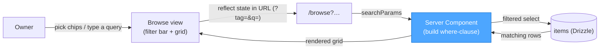

# Browse, Filter & Search: Specification Set

> **Set ID:** `SPEC-SET-BROWSE` · **Version:** `0.4.0` · **Status:** DRAFT · **Owner:** nnworkspace

Phase 2, built on the Catalog MVP (#8). A single **browse** view over the whole wardrobe (every item, across all categories) that the owner narrows with **tag filters** (occasion / feel / season / care), a **colour-family filter**, and a **free-text search** (name / brand / material / colour / tags). v0.2.0 (#105) reshapes the filters into a collapsible **Search & filter** panel of compact multi-select **dropdowns** (one per facet), and makes that same panel available on **category pages** too (combined with the category). It reuses the Catalog item model unchanged and adds no new data; it is a read-only lens over what is already stored.

## 1. Purpose

The category grid answers "show me my dresses." Browse answers the cross-cutting questions: "what do I have for a warm office day?", "which linen pieces?", "everything tagged *occasion*." It filters by the tags already captured at add-time and matches a typed query against the item's name, brand, material, and tags (so a word like "summer" works whether you tap the chip or type it), server-side, shareable by URL, with nothing new to store.

## 2. Scope

| In scope | Out of scope |
|:--|:--|
| A global `/browse` view listing all items in the store-style grid | New data model (reuses `items` + `tags`) |
| Per-facet multi-select dropdowns: **occasion / feel / season / care + style (neck/sleeve/silhouette/fit/length)**, plus **colour families**, **material** fibres (#263) and a **favourites** toggle (#135) | Filtering by numeric fields (price ranges, dates): later if wanted |
| Free-text search on **name / brand / material / tags** | Search over description / notes (a later, richer pass) |
| Combining filters + search; clear-all; empty state | **Semantic / natural-language search**: a future AI phase (embeddings + pgvector) |
| URL-reflected state (shareable, bookmarkable, survives refresh) | Saved searches / smart collections |

Search here is deliberately **keyword-only (no AI)**. Meaning-based search ("something for a summer wedding") is recorded as a future AI phase (it needs embeddings, not SQL) and is out of scope for Phase 2.

## 3. Traceability

| Anchor | Reference |
|:--|:--|
| Stack | [ADR-0001](../../_governance-local/decisions/ADR-0001-tech-stack.md) |
| Data layer / item model / tags-as-array | [ADR-0002](../../_governance-local/decisions/ADR-0002-data-layer.md) |
| Validation (Zod) | [ADR-0006](../../_governance-local/decisions/ADR-0006-validation-library.md) |
| Catalog **data model** (the fields it reads) | [`SPEC-CATALOG-DATA`](../catalog/30-data-model-spec.md) |
| Catalog grid / item card it reuses | [specs/catalog/](../catalog/) |
| This feature's issue | #38 |

## 4. Specification artefacts

| ID | File | Role |
|:--|:--|:--|
| `SPEC-BROWSE-FUNC` | [10-functional-spec.md](10-functional-spec.md) | Operations, filter/search semantics, validation rules |
| `SPEC-BROWSE-INT` | [20-interface-spec.md](20-interface-spec.md) | Route, URL contract, server query, UI, flows |
| | [manifest.yaml](manifest.yaml) | Inventory |

No `30-data-model` of its own: the feature persists nothing. It **reads the Catalog data model** ([`SPEC-CATALOG-DATA`](../catalog/30-data-model-spec.md), implemented in [`src/db/schema.ts`](../../src/db/schema.ts)): the `tags` field it filters on and searches (defined there as *Phase 1 capture / Phase 2 filter*), `name` / `brand` / `material` it searches, `category` and `created_at` for scope and order, and `item_photos` for the grid card. No columns are added.

## 5. Feature context

## 6. How to read this set

1. **This README** for scope and context.
2. **[10-functional-spec.md](10-functional-spec.md)**: what it lists and the filter/search rules (`VAL-BROWSE-*`).
3. **[20-interface-spec.md](20-interface-spec.md)**: the route, the URL contract, the Drizzle query, and the UI.
