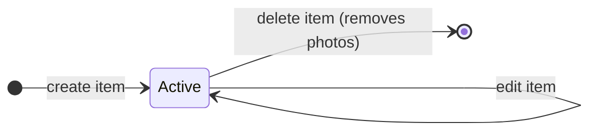

# Catalog: Functional Specification

- **Spec ID:** `SPEC-CATALOG-FUNC`
- **Part of set:** `SPEC-SET-CATALOG` v0.1.0
- **Traceability:** [ADR-0001](../../_governance-local/decisions/ADR-0001-tech-stack.md), [ADR-0002](../../_governance-local/decisions/ADR-0002-data-layer.md); issue #6

## 1. Purpose and scope

Defines the functional behaviour of the Catalog: the item lifecycle, the operations the owner can perform, and the validation rules enforced on each. Field-level detail is in [30-data-model-spec.md](30-data-model-spec.md); routes and flows are in [20-interface-spec.md](20-interface-spec.md).

## 2. Item lifecycle

Phase 1 uses a **flat lifecycle**: an item either exists or it does not. There are no draft or archived states yet (archiving is a later enhancement, §6). Wear tracking is a separate feature ([`SPEC-SET-WEAR`](../wear-tracking/)) with its own `wear_events` table; it does not change an item's lifecycle.

## 3. Operations

### 3.1 Create item: `OP-ITEM-CREATE`

- **Purpose:** record a new piece of clothing, optionally with rich detail copied from the brand's product page.
- **Trigger:** the owner submits the add form (`/items/new`), which calls the `createItem` Server Action.
- **Inputs:** `name` and `category` (required). Everything else is optional: one or more **photos**; identity (`brand`, `product_code`, `color`, `size`, `product_url`); pricing (`list_price_cents`, `price_paid_cents`, `currency`); purchase & returns (`purchased_at`, `purchase_channel`, `return_by`, `return_policy`); curation (`favorite`, `tags`, `notes`); descriptive (`description`, `material`, `care`); and any brand-specific sections as `details` label/value pairs.
- **Outcomes:**
  - **Success:** photos are stored, the item is saved, and the owner is redirected to its detail page.
  - **Validation failure:** the form is redisplayed with per-field errors; nothing is stored.
- **Note:** AI-assisted import (Phase 1.5) pre-fills this same set of fields from a screenshot or a saved product page for the owner to review before saving; it does not change this operation's contract.

### 3.2 View item: `OP-ITEM-VIEW`

- **Purpose:** see an item's photos and full details.
- **Trigger:** navigating to `/items/[id]`.
- **Outcomes:** the item is rendered (photos as a gallery; `care`, `notes` and `description` rendered from Markdown; `details` shown as labelled sections); a non-existent id yields a not-found page.

### 3.3 Edit item: `OP-ITEM-EDIT`

- **Purpose:** correct or enrich an item (including adding photos or detail later).
- **Trigger:** the owner submits the edit form (`/items/[id]/edit`), which calls `updateItem`.
- **Outcomes:** on success the changes are saved (added photos stored; removed photos deleted from storage; photos **reordered** within their kind group and the chosen **cover** applied, per `VAL-ITEM-03`) and the owner returns to the detail page; on validation failure the form is redisplayed with errors.

### 3.4 Duplicate item: `OP-ITEM-DUPLICATE`

- **Purpose:** catalog the same style in another colour/size without re-typing everything (one order often yields several near-identical pieces).
- **Trigger:** the owner clicks **Duplicate** on a detail page → the add form opens pre-filled from that item (`/items/new?from={id}`).
- **Behaviour:** every field is seeded from the source (name, category, brand, product code, colour, size, prices, currency, purchase info, material, care, description, details, tags, favourite) **except photos and wear history**, which are per-item. Nothing is written until the owner saves.
- **Outcomes:** the owner edits (colour, photos, …) and submits → `createItem` makes a **new** item; the source is untouched.

### 3.5 Delete item: `OP-ITEM-DELETE`

- **Purpose:** permanently remove a piece.
- **Trigger:** the owner confirms deletion (confirmation dialog) on the detail page; calls `deleteItem`.
- **Outcomes:** the row is hard-deleted (its `item_photos` cascade-delete) and all its stored photos removed; the owner is returned to the item's category (or home).

### 3.6 Browse by category: `OP-CATALOG-BROWSE`

- **Purpose:** see the wardrobe like a store.
- **Trigger:** the home page (`/`) shows all categories with counts; `/category/[slug]` shows the items in one category, those whose **primary or a secondary** category is the slug (#71), so a multi-category piece appears on each of its category pages.
- **Outcomes:** items are shown as a photo grid (primary photo, or a placeholder), newest first; an empty category shows a friendly empty state. Each thumbnail crops the cover to fill its 3:4 frame, unless the piece has `show_full_cover` set, in which case the whole cover is fit inside the frame (letterboxed on the muted background), for photos whose shape does not match the card (e.g. a full-length shot).
- **Sub-category navigation (#78, #84):** on a category that is part of a family (a parent or one of its children), a dezent chip row lets the owner filter between **All \<parent\>** (the roll-up) and each sub-category; a parent also offers **Not categorised** (pieces filed directly at the parent with no sub-type yet). See the interface spec §4.1.

## 4. Business validation rules

Enforced inside the Server Actions (`createItem` / `updateItem` / `deleteItem`).

| Rule ID | Validation |
|:--|:--|
| `VAL-ITEM-01` | `name` is required, trimmed, non-empty, ≤ 120 characters. |
| `VAL-ITEM-02` | `category` (the primary) is required and must be one of the known category slugs ([30-data-model §6](30-data-model-spec.md)): a top-level category or a sub-category (#78). `secondary_categories` (#71) is optional, each entry a known slug, de-duplicated and with the primary removed, so a piece appears under its primary category **and** each extra. A category page **rolls up** its sub-categories: `/category/jewellery` lists items in jewellery or any descendant (e.g. `rings`); `/category/rings` lists just rings. |
| `VAL-ITEM-03` | Photos are optional (0–10). Each must be an image (`image/jpeg`, `image/png`, `image/webp`, or `image/avif`, accepted by **MIME type or filename extension**, since some browsers mislabel `.avif`/`.webp` as `application/octet-stream`) and ≤ 10 MB. If any photo exists, exactly one is marked primary: the **cover**, which the owner may set to **any** photo of either kind. The owner arranges photo order by drag-and-drop **within each kind group** (Official / Mine); order and cover persist to `sort` / `is_primary`. |
| `VAL-ITEM-04` | `list_price_cents` and `price_paid_cents` are optional; if present, non-negative integers (minor units). `currency` is ISO 4217, default `EUR`. |
| `VAL-ITEM-05` | `tags` are optional; each must belong to the known tag vocabulary ([30-data-model §7](30-data-model-spec.md)); duplicates are removed. |
| `VAL-ITEM-06` | `purchased_at` is optional; if present, a valid date not in the future. |
| `VAL-ITEM-07` | `return_by` is optional; if present, a valid date and (when `purchased_at` is set) not before it. It may be in the future: it is a deadline. |
| `VAL-ITEM-08` | Free-text length caps: `brand` ≤ 120, `color` ≤ 60, `size` ≤ 40, `product_code` ≤ 60, `purchase_channel` ≤ 120, `material` ≤ 500, `care` ≤ 1000, `return_policy` ≤ 2000, `notes` ≤ 4000, `description` ≤ 4000. `product_url`, if present, is a valid URL ≤ 2048. |
| `VAL-ITEM-09` | `details` is optional; an ordered array of `{label, value}` objects with non-empty `label` ≤ 120, `value` ≤ 4000, at most 30 entries. |
| `VAL-ITEM-10` | `care`, `notes` and `description` accept Markdown and are rendered with a sanitized renderer; raw HTML/scripts never execute. `care` was added to this list in #237: it carries the maker's instruction quoted verbatim and the owner's advice below it, and that separation is held entirely by emphasis and bullets. Rendered flat, the field loses the one distinction it exists to make. |
| `VAL-ITEM-11` | On delete, and on photo removal/replacement during edit, the affected storage objects are removed best-effort; a storage-deletion failure is logged but does not block the DB operation. |
| `VAL-ITEM-12` | `storage_location` (the **"Berth"**, where the piece is kept, #172) is optional, trimmed, ≤ 31. Shown on the overview card (beside brand/size) and beside the brand on the item detail page; included in the browse keyword search; browsable at `/berths`. |
| `VAL-ITEM-13` | **A rejected save is never silent** (#238). When validation fails the whole submit is discarded, so the form must say so: a summary lists **every** field the action rejected, named by its form label, and takes focus. The summary is built from the returned errors rather than from a hand-maintained list of fields, so a field added to the schema later cannot be rejected without being reported. Before this, ten fields had an inline message and the rest had none: an over-long `care` value discarded an edit to the Berth with no message at all. |

Where an input fails a rule, the operation is rejected as a whole (no partial writes) and the offending field(s) are reported back to the form.

## 5. Category browsing behaviour

- The home page lists every category with a **live count** of its items.
- A category page shows items **newest first** (by `created_at` descending).
- **Empty states:** a category with zero items shows a short prompt and an "Add a piece" action rather than an empty grid.

## 6. Out of scope / future

- **A berth picker / autocomplete is deliberately rejected** (#202). Suggesting previously-used berths would prevent typos in principle, but the codes differ by a single character (`R1-W7R2-S3-R` against `R1-W7R2-S4-R`), so a dropdown of near-identical strings makes selecting the *wrong* shelf easier, not harder, and a mis-picked berth is silently wrong where a typo is at least visible. The owner types them by hand by choice (2026-07-28). Revisit only if berth codes ever become visually distinct.

- **AI-assisted import** from a product URL or screenshot (Phase 1.5): pre-fills the create form, with its own spec set and ADR.
- **Tag filtering and search** (Phase 2): tags are captured now but not yet used to filter.
- **Archiving** an item instead of hard delete.
- **Wear tracking**: logging wears and cost-per-wear, now specified in [`SPEC-SET-WEAR`](../wear-tracking/) (a `wear_events` table; the reserved `wear_count` / `last_worn_at` columns were dropped in favour of it).
- **Return-window reminders** driven by `return_by`.
- **Trips, outfits, authentication**: later phases.
