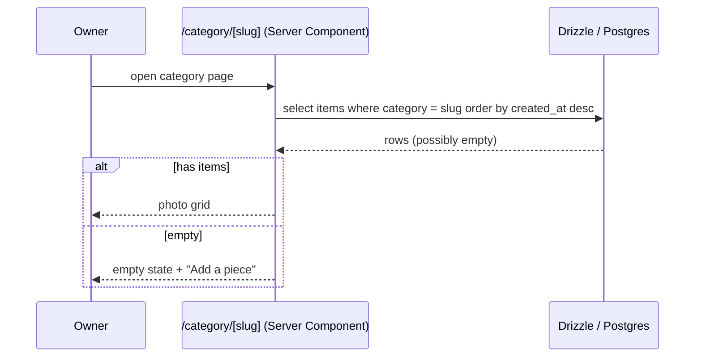
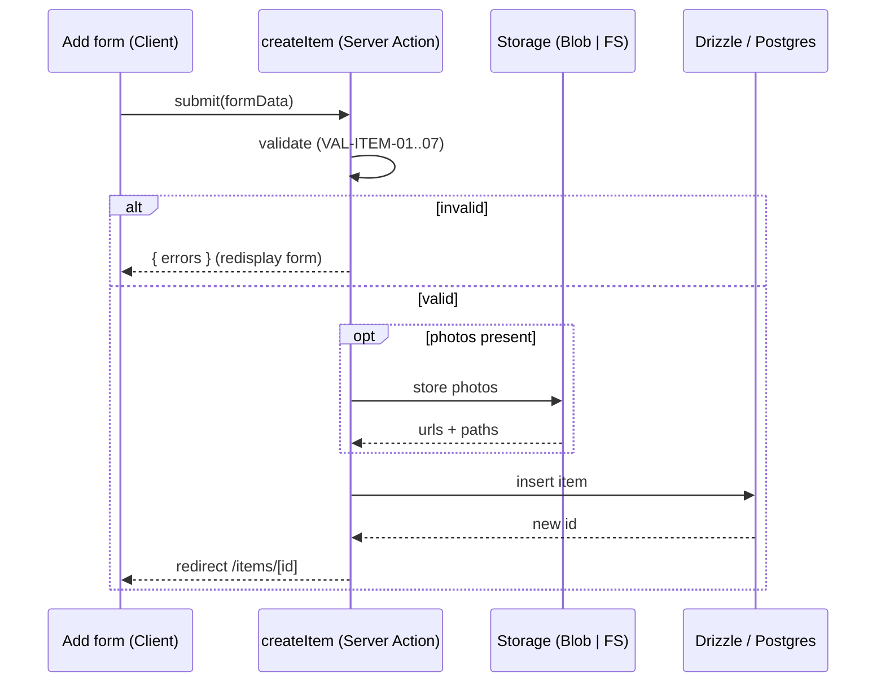
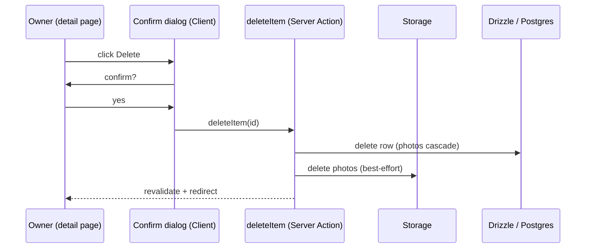

# Catalog — Interface Specification

- **Spec ID:** `SPEC-CATALOG-INT`
- **Part of set:** `SPEC-SET-CATALOG` v0.1.0
- **Traceability:** `SPEC-CATALOG-FUNC` (operations in §3); [docs/ARCHITECTURE.md](../../docs/ARCHITECTURE.md); issue #6

## 1. Purpose and scope

Defines how the Catalog is exposed to the owner: the routes (pages), the Server Actions that mutate data, and the interaction flows. There is no external HTTP API — mutations are Next.js Server Actions invoked from client components (see [ADR-0001](../../_governance-local/decisions/ADR-0001-tech-stack.md)).

## 2. Routes

| Route | Kind | Purpose | Implements |
|:--|:--|:--|:--|
| `/` | Server Component | Home: category grid with live counts, "Add a piece" | `OP-CATALOG-BROWSE` |
| `/category/[slug]` | Server Component | Items in one category (rolled up over sub-categories), newest first, with empty state; a dezent sub-category filter row when the category is part of a family (#78, #84) | `OP-CATALOG-BROWSE` |
| `/items/new` | Server Component page + Client form | Add-item form | `OP-ITEM-CREATE` |
| `/items/[id]` | Server Component | Item detail; edit + delete actions | `OP-ITEM-VIEW`, entry to `OP-ITEM-DELETE` |
| `/items/[id]/edit` | Server Component page + Client form | Edit-item form | `OP-ITEM-EDIT` |

Reads happen in Server Components (direct Drizzle queries). Forms and the delete confirmation are Client Components that call Server Actions.

## 3. Server Actions

Conceptual signatures (final types live with the code):

| Action | Input | Result |
|:--|:--|:--|
| `createItem(formData)` | multipart form (fields + optional photos + `details`) | on success: redirect to `/items/[id]`; on failure: `{ errors }` for the form |
| `updateItem(id, formData)` | id + form | on success: redirect to `/items/[id]`; on failure: `{ errors }` |
| `deleteItem(formData)` | form with a hidden `id` | on success: redirect to the item's category or `/`; storage-deletion errors logged, not fatal |

All three validate against the `VAL-ITEM-*` rules (functional spec §4) before writing, and revalidate the affected routes (`/`, the category page, the item page) so the UI reflects the change.

Photo uploads travel in the Server Action body, so the Next.js Server Action body limit is raised to 30 MB (`next.config.ts`) to accommodate multi-MB phone photos. (A future optimisation is direct client-to-Blob upload, which would keep large bodies out of the action.)

## 4. Flows

### 4.1 Browse a category — `STEP-BROWSE-*`

- `STEP-BROWSE-01` open category page → `STEP-BROWSE-02` query items → `STEP-BROWSE-03` render grid or empty state.
- **Sub-category filter row (#78, #84).** When the category belongs to a family (a parent with children, or one of its children), the page shows an understated ("dezent") row of chip links near the top: **All \<parent\>** (the full roll-up) plus each sub-category, with the current one marked, so the owner can filter between them. A parent additionally gets a **Not categorised** chip (`?sub=none`) listing pieces filed directly at the parent with no sub-type chosen yet — its "still to sort" bucket. Top-level categories with no children show no row.

### 4.2 Create an item with a photo — `STEP-CREATE-*`

- `STEP-CREATE-01` submit → `02` validate → `03` (optional) store photos → `04` insert row (+ photo rows) → `05` revalidate + redirect.

### 4.3 Delete an item — `STEP-DELETE-*`

## 5. UI states

- **Loading:** category and detail pages use skeletons (`skeleton` component) during navigation.
- **Empty:** categories with no items show a prompt + "Add a piece" (see functional spec §5).
- **Validation errors:** shown inline per field on the add/edit forms.
- **Floating save (#103):** the add/edit form shows a floating round **Save** button (a disc icon) fixed to the viewport bottom-right — a submit button that saves from any scroll position, with a spinner while pending. The inline Save at the form's end remains; the browser Back button serves as cancel.
- **Favourite heart (#117):** favourites use a **heart** (rose). Every grid card carries a heart overlay (top-right) — outline when not a favourite, filled when it is — that toggles the piece's `favorite` **straight from the overview** via the `toggleFavorite` server action (optimistic), no need to open the piece. The item page shows a filled heart by the name; the add/edit form keeps the "Mark as favourite" checkbox (now with a heart). Favourites are also filterable from browse and reachable via the **Favourites** nav entry (#135, see [specs/browse](../browse/)).
- **Log a wear (#121, #129):** the same card carries a **calendar** overlay on the opposite corner (top-left). It opens a small modal pre-filled with today's date, plus occasion and note, and appends a `wear_event` — the grid-side entry point to `OP-QUICK-LOG-WEAR` (see [specs/wear-tracking](../wear-tracking/)). Both overlays sit over the card as siblings of its link, so neither navigates.
- **The category setter (#206)** is two clearly separated controls, in this order:
  1. **Main category** — the single required choice, with help text stating that every piece has exactly one and that changing it here moves the piece. This *is* the way to re-file something.
  2. **Also in** — the extra categories. The **primary never appears here**: it is set above, and rendering it as a permanently-ticked, disabled box was a dead end the owner reasonably tried to use.
  - **Ticking a sub-category ticks its family**, shown ticked, greyed and labelled *"via <sub-category>"*, and not editable — it is a consequence, not a choice. Implied boxes are **not submitted**; the server re-derives them, so nothing depends on the form posting them.
  - Families flow into **CSS columns sized by width** (`columnWidth: 7.5rem`), each family `break-inside-avoid` so a parent is never separated from its sub-types. This replaced a single wrapping flex row that **overflowed horizontally** on a narrow window and pushed items off the right edge where they could not be reached.
  - **The column count is never fixed.** An explicit count was tried and rejected by the owner — it needs a rule per breakpoint and still guesses wrong. The browser is told the *minimum comfortable column width* and works the count out; the density that makes four columns fit at a typical window came from shrinking the padding and gaps, not from asserting a number. Long labels (*Underwear and Pyjamas*) **wrap** rather than truncate, with the checkbox top-aligned to the first line.
- **Field order on the add/edit form (#202):** fields are grouped by *what kind of fact they are*, and the groups run **basics → identity → purchase → tags → text → details → wear log → photos**. The **berth** lives in the **identity** group, directly after size, and is labelled with a **pin icon** matching the detail page and the card. It does **not** belong with the purchase fields: price, purchase date, channel and return terms are fixed at the moment of buying, whereas a berth is where the piece lives *now* and changes whenever a shelf is reorganised. It is also the field edited most often after filing, so it must be reachable without hunting.
- **Copying a name (#217).** Hovering a piece's name on its card reveals a copy control; it also appears on keyboard focus, and stays permanently visible on touch devices, where there is no hover at all. Confirmation is a check for ~1.5s rather than a toast, because these are used several times in a row — and the accessible name follows the state ("Copied"), so the confirmation is not purely visual. A failed copy says so: `navigator.clipboard` rejects outside a secure context, and silence would leave the owner pasting something else.
  - **The card became a stretched link because of it.** A card whose whole surface is an `<a>` may not legally contain a button, so the content is now plain markup with an `absolute inset-0` anchor over it and the control raised above on `z-10`. The whole card stays clickable and the link gains a clean accessible name (the piece's name) instead of the photo alt, name, brand and size run together.
- **Feedback:** successful create/edit/delete surface a toast (`sonner`); unexpected errors surface an error toast.
- **Photos:** shown as a gallery on the detail page (primary first) and as the thumbnail in grids, via `next/image`; a placeholder is shown for items without a photo. Tapping one opens the full-screen viewer — [`PhotoViewer`](../../src/components/photo-viewer.tsx), which is **shared with a look's photos** (#195) rather than duplicated, so pan-clamping (#127) and visual-viewport sizing (#131) behave identically in both places. Its wrap-around rule is the pure `stepIndex` (`src/lib/photos.ts`), tested without a DOM.
- **Rich text:** `notes` and `description` are rendered from Markdown (sanitized); `details` entries render as labelled sections.
