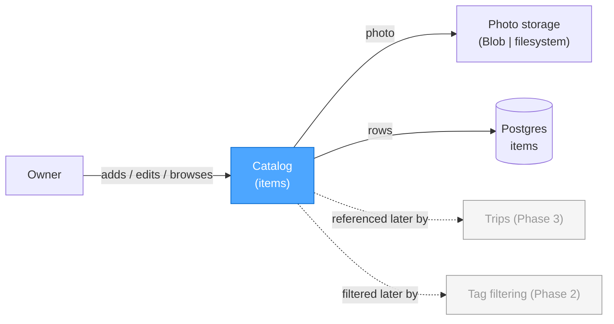

# Catalog — Specification Set

> **Set ID:** `SPEC-SET-CATALOG` · **Version:** `0.1.0` · **Status:** DRAFT · **Owner:** nnworkspace

This is the first per-feature spec set. It follows a layered, ID'd, Mermaid-based specification style, scaled to a solo web app: no OpenAPI (the app has no external API — it uses Server Actions), no upstream traceability tags, and no frontmatter. Traceability points to the repository's ADRs and GitHub issues instead.

## 1. Purpose

The Catalog is the heart of the app: it lets the owner record each piece of clothing with a photo and details, browse the wardrobe grouped by category like a fashion store, and keep the collection up to date. It is Phase 1 of the roadmap and the foundation every later feature (tagging, trips, outfits) builds on.

## 2. Scope

| In scope (Phase 1) | Out of scope (later phases) |
|:--|:--|
| Create an item: name + category required; rich optional detail (brand, code, colour, size, prices, purchase + return info, description, material, care) | AI-assisted import from URL/screenshot (Phase 1.5) |
| Multiple photos per item (your own + the official shot) | Tag-based filtering / search (Phase 2) |
| Brand-specific extras via a flexible `details` (label/value) field | Trips & packing lists (Phase 3) |
| Markdown-formatted `notes` and `description` | Outfits & "what to wear" (Phase 4) |
| Per-item return window + policy | Wear tracking → its own feature ([wear-tracking/](../wear-tracking/)) |
| View / edit / delete an item (and its photos) | Return-window reminders |
| Browse a store-like grid grouped by category, with counts | Authentication / multi-user |
| Capture tags on an item (filtering comes in Phase 2) | Store shipping/return policy pages, weather-aware packing |

## 3. Traceability

| Anchor | Reference |
|:--|:--|
| Stack decision | [ADR-0001](../../_governance-local/decisions/ADR-0001-tech-stack.md) |
| Data layer | [ADR-0002](../../_governance-local/decisions/ADR-0002-data-layer.md) |
| Photo storage | [ADR-0003](../../_governance-local/decisions/ADR-0003-photo-storage.md) |
| Architecture | [docs/ARCHITECTURE.md](../../docs/ARCHITECTURE.md) |
| This spec's issue | #6 |
| Phase 1 build | (feature ticket, opened after this spec merges) |

## 4. Specification artefacts

| ID | File | Role |
|:--|:--|:--|
| `SPEC-CATALOG-FUNC` | [10-functional-spec.md](10-functional-spec.md) | Item lifecycle, operations, validation rules |
| `SPEC-CATALOG-INT` | [20-interface-spec.md](20-interface-spec.md) | Routes, Server Actions, UI flows (Mermaid) |
| `SPEC-CATALOG-DATA` | [30-data-model-spec.md](30-data-model-spec.md) | Item fields, types, constraints, schema mapping |
| — | [manifest.yaml](manifest.yaml) | Machine-readable inventory |

## 5. Feature context

## 6. How to read this set

1. **This README** for scope and context.
2. **[10-functional-spec.md](10-functional-spec.md)** — what the Catalog does: the item lifecycle, the operations, and the `VAL-ITEM-*` rules.
3. **[20-interface-spec.md](20-interface-spec.md)** — how it's exposed: routes, Server Actions, and the UI flows.
4. **[30-data-model-spec.md](30-data-model-spec.md)** — the exact item fields and how they map to the Drizzle schema.
