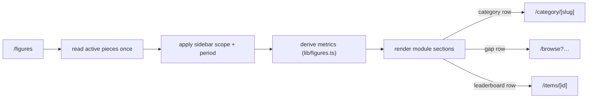

# Figures — Interface Specification

- **Spec ID:** `SPEC-FIGURES-INT`
- **Part of set:** `SPEC-SET-FIGURES` v0.1.0
- **Traceability:** `SPEC-FIGURES-FUNC`; [ADR-0007](../../_governance-local/decisions/ADR-0007-design-system.md); issue #181

## 1. Route

| Route | Renders |
|:--|:--|
| `/figures` | The dashboard: sidebar + the module sections, in phase order |
| `/figures?scope=all` | Including archived pieces (`VAL-FIG-01`) |
| `/figures?year=2026` | Scoped to one purchase year (`VAL-FIG-06`) |

A Server Component marked `dynamic = "force-dynamic"`, like every data-backed page, so the figures always reflect current data. Nav entry **Figures**, beside **Berths**.

Filters live in the **URL**, not component state: a filtered view is linkable, survives a refresh, and the back button behaves. No Server Actions — the page mutates nothing (`VAL-FIG-09`).

## 2. Layout

```
┌───────────────┬────────────────────────────────────────────┐
│  Figures      │  Wardrobe                                  │
│               │  120 pieces · €9,800 · 24 dresses          │
│ ▸ Overview    │  ┌─────┬─────┬─────┬─────┬─────┬─────┐     │
│   Collection  │  │ 120 │ €10k│  18 │ €82 │  14 │  11 │     │
│   Spending    │  └─────┴─────┴─────┴─────┴─────┴─────┘     │
│   Wear&Value  │                                            │
│   Gaps        │  Collection                                │
│   Colour      │  Dresses    ████████████████ 24            │
│   Care        │  Tops       ██████████████   34            │
│ ───────────── │  …                                         │
│  Scope        │                                            │
│  ● Active     │  Spending & acquisition                    │
│  ○ + Archived │  ▁▂▃▅▂▇▃█  2014 … 2026                     │
│  Year   [▾]   │                                            │
└───────────────┴────────────────────────────────────────────┘
```

- **Sidebar** (`lg:` and up): sticky, doing two jobs — section navigation with scroll-spy highlighting, and the global filters. Below `lg` it collapses to a horizontal chip row above the content; the filters move into a compact row beneath it.
- **Main column**: one `<section>` per module, each with an `id` the sidebar links to, in the phase order of [`SPEC-FIGURES-FUNC`](10-functional-spec.md) §2.
- Follows the existing page shell (`max-w`, serif headings, sharp edges) — Figures introduces no new visual language.

## 3. Charts

**Inline SVG and CSS only — no charting dependency.** The chart types needed are few and simple, and a library would add weight and a visual dialect the app does not otherwise speak.

| Module | Mark | Why |
|:--|:--|:--|
| Collection | Horizontal bars | Category names are long; horizontal keeps them readable and sortable by length |
| Spending & acquisition | Vertical bars + a second series | A timeline reads left-to-right; the second series carries spend against count |
| Wear & value | Ranked lists with an inline bar | Leaderboards are read as lists; the bar is for proportion, not precision |
| Colour | A swatch beside each named family, with a bar for count | The swatch **is** the datum — literal encoding, not an assigned palette. The name always sits beside it, so identity never rests on colour alone, and a hairline ring keeps a near-white family visible |
| Fabric, care, season | Plain bars in **one** hue | **Not** a segmented or stacked bar: a piece carries several care tags, spans several seasons, and a blend names several fibres — so the parts genuinely do not sum, and a part-to-whole mark would assert a whole that does not exist (`VAL-FIG-05`). One hue, because these categories are nominal: colouring each bar darker-where-bigger would double-encode length as hue |

Every chart is preceded by its headline number in text, so the figure is legible without interpreting the graphic, and remains legible to a screen reader. Bars carry `title`/`aria-label` with the exact value.

**Care and season keep their vocabulary order** (easy → demanding; spring → winter) rather than being sorted by size: the order carries meaning, and re-ranking it would throw that away for no gain.

## 4. Flow



Every outbound link lands in an existing view; Figures adds no new destinations of its own.

## 5. States

| State | Renders |
|:--|:--|
| Empty wardrobe | A single sentence inviting the first piece — no zeroed tiles, no empty axes (`VAL-FIG-04`) |
| A module with no data under the current filter | That module's own short sentence, the rest of the page unaffected |
| Partial data | The figure, plus its base ("across the 38 pieces with wear data") (`VAL-FIG-03`) |
| Overlapping dimensions | A one-line note that the parts exceed the whole (`VAL-FIG-05`) |

## 6. Accessibility & responsiveness

- Sidebar links are ordinary anchors to section ids: keyboard-navigable, and the page works with JavaScript disabled apart from scroll-spy highlighting.
- Charts are decorative wrappers around text values; nothing is conveyed by colour alone (the colour module names each family in text beside its swatch).
- Tables and wide charts scroll inside their own container; the page body never scrolls horizontally.
- Numbers use tabular figures so columns align.

## 7. Testing surface

This feature introduces the **query-layer test tier** (#183 L2): metric functions in `lib/figures.ts` are pure over an array of pieces, so they are tested with the existing fixture catalogue and no database. Tests are named after the rule they defend — `VAL-FIG-03`, `VAL-FIG-07` — per ADR-0014.
