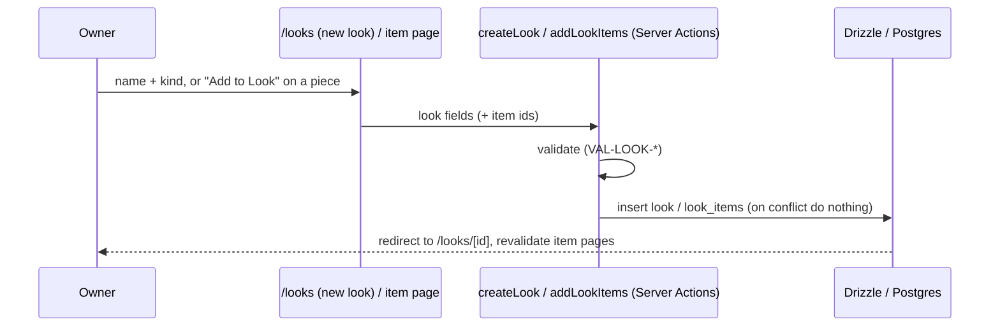

# Looks: Interface Specification

- **Spec ID:** `SPEC-LOOKS-INT`
- **Part of set:** `SPEC-SET-LOOKS` v0.4.0
- **Traceability:** `SPEC-LOOKS-FUNC` (rules §4); [docs/ARCHITECTURE.md](../../docs/ARCHITECTURE.md); reuses the wardrobe picker & cover-collage from [`SPEC-SET-TRIPS`](../trips/) / [`SPEC-SET-CATALOG`](../catalog/) and the storage abstraction ([ADR-0003](../../_governance-local/decisions/ADR-0003-photo-storage.md)); issues #95, #98, #100, #170

## 1. Purpose and scope

How Looks are exposed and wired: the routes, the Looks list, the Look detail, the per-piece section on the item page, and the Server Actions behind them. Reads run in Server Components; writes are Server Actions (no hand-written API), consistent with Catalog / Trips.

## 2. Routes

| Route | Purpose |
|:--|:--|
| `/looks` | Looks list + "New look" (`OP-LOOK-CREATE`). A new header **"Looks"** nav item links here. |
| `/looks/[id]` | Look detail = its pieces (`OP-LOOK-*` for members); **Archive / Restore / Delete** the look (`OP-LOOK-ARCHIVE` / `-RESTORE` / `-DELETE`, #170). |
| `/looks/[id]/edit` | Edit look details (`OP-LOOK-EDIT`). |
| `/archive` | Unified archive. Retired **looks** are listed below archived pieces (#170); the look stays clickable to view/restore. |

`/items/[id]` gains an **"In these Looks"** + **"Goes with"** section and an **"Add to Look"** control. A non-existent look id yields a not-found page. Archiving a piece that belongs to active looks shows a **reminder** listing them (with links), so the owner can edit/retire them; no cascade (#170).

## 3. UI

### 3.1 Looks list (`/looks`)
- A **"New look"** action opening the look form (name, kind, notes).
- Each Look is a card: **name**, a **kind badge** (*Set* / *Look*), **piece count**, and a **cover**, which is the Look's **own primary photo** if it has one, else a **collage** of its pieces (the catalog collage; placeholder when both are empty). A look with an archived member shows an **Incomplete** badge (#170). Cards link to the Look. Newest first; **archived looks are excluded** (they live on `/archive`). Empty state: a prompt + "New look".

### 3.2 Look detail (`/looks/[id]`)
- **Header:** name, kind badge, notes; **Edit**, **Archive/Restore**, and **Delete** controls (#170). An archived look shows an **Archived** banner (reason · date); an active look with an archived member shows an **Incomplete** notice. Archive asks for a date + reason (`no-longer-wear` / `piece-archived` / `outdated` / `other`) + optional note; Delete warns that only the look and its links go (the pieces stay) and offers "Archive instead".
- **Photos:** the Look's **own photos** (the cover first), each a thumbnail with a **remove** (✕) and a **set-as-cover** (★) control (`OP-LOOK-REMOVE-PHOTO`, `OP-LOOK-SET-COVER`), plus an **upload** control (multi-file, `OP-LOOK-ADD-PHOTOS`). No own photos yet: just the upload control with a hint that the piece-collage is used as the cover meanwhile.
- **Three targets share each thumbnail** (#195), and each does exactly one thing:

  | Target | Action | Confirms first |
  |:--|:--|:--|
  | the photo | opens the full-screen viewer at that photo (`OP-LOOK-VIEW-PHOTO`) | none |
  | ★ | sets the Look's cover | no: immediate, and reversible by choosing another |
  | ✕ | deletes the photo | **yes**: a modal, `Cancel` / destructive `Remove` (`VAL-LOOK-13`) |

  The controls are siblings of the photo button, not nested inside it, and stop propagation, so neither can open the viewer. The viewer is [`PhotoViewer`](../../src/components/photo-viewer.tsx), shared with the item gallery: extracted rather than reimplemented so the pan-clamping (#127) and visual-viewport sizing (#131) fixes hold in both places. Deleting while the viewer is open closes it, since the indices behind the removed photo have shifted.
- **Pieces:** the Look's members in **one flat grid**, horizontal-first, in the owner's **manual order**, with no category headings (#100). Each card is a **cover thumbnail** + name + brand (linking to the item) with a **remove** (✕) control (`OP-LOOK-REMOVE-ITEM`) and a **drag handle**; **drag to reorder** (`OP-LOOK-REORDER`), persisted on drop. List / grid view toggle (reuse the trips `ViewToggle`); reordering is done in the grid.
- **"Add pieces"** opens the wardrobe picker (§3.4). Empty Look: a prompt + the picker.

### 3.3 Item detail: Looks section
On `/items/[id]`:
- **In these Looks:** chips for each **active** Look the piece is in, labelled by kind ("Part of the **X** set" / "In the **Y** look"), linking to each Look. Archived looks are excluded (#170).
- **Goes with:** thumbnails of the distinct other pieces across those Looks (the piece's curated matches), each linking to the item. Absent when the piece is in no Looks.
- **"Add to Look":** a control (menu/dialog) to add this piece to an existing Look or create one → `addLookItems`.

### 3.4 Wardrobe picker (on the Look page)
Reuse the trips **`WardrobePicker`**: grouped-by-category thumbnail grid, search, per-facet filters + colour + sort (#113), multi-select, pinned "Selected" tray. **Add selected** → `addLookItems(lookId, itemIds)`. Pieces already in the Look show as added (disabled), so it is safe to reopen.

## 4. Server Actions

| Action | Input | Result |
|:--|:--|:--|
| `createLook(formData)` | name, kind, notes? (+ optional seed itemIds) | inserts a `look` (and any seed `look_items`); redirect to `/looks/[id]`; or `{ errors }` |
| `updateLook(id, formData)` | name, kind, notes | updates the `look`; redirect to `/looks/[id]`; or `{ errors }` |
| `deleteLook(formData)` | look id | deletes the look (cascades `look_items` **links only, pieces untouched**, #170); revalidates member item pages; redirect to `/looks` |
| `archiveLook(id, {archivedAt, reason, note?})` | look id + archive fields | soft-archives the look (`VAL-LOOK-10`); revalidates `/looks`, the look, and member item pages; `{ ok }` / `{ error }` (#170) |
| `restoreLook(id)` | look id | clears the three archive fields; revalidates as above; `{ ok }` / `{ error }` (#170) |
| `addLookItems(formData)` | look id + item id(s) | inserts `look_item`(s), **on-conflict-do-nothing** (`VAL-LOOK-05`); revalidates the look + affected item pages |
| `removeLookItem(formData)` | look id + item id | deletes that `look_item`; revalidates |
| `addLookPhotos(formData)` | look id + image file(s) | validates (`VAL-LOOK-07`), stores via `putPhoto`, appends `look_photo`(s); first photo becomes cover (`VAL-LOOK-08`); revalidates `/looks` + `/looks/[id]` |
| `deleteLookPhoto(formData)` | look id + photo id | deletes the `look_photo` and its stored object; promotes the next cover if needed (`VAL-LOOK-08`); revalidates |
| `setLookCover(formData)` | look id + photo id | marks the photo `is_primary`, clears the others (`VAL-LOOK-08`); revalidates |
| `reorderLookItems(formData)` | look id + ordered item ids | writes each piece's position to `look_items.sort` (`VAL-LOOK-09`, #100); revalidates the look |

The member/detail actions validate with Zod (ADR-0006) against `VAL-LOOK-*` before writing; the photo actions validate image type/size/count (`VAL-LOOK-07`). All revalidate `/looks`, `/looks/[id]`, and any affected `/items/[id]`.

## 5. Flows

### 5.1 Build a Look: `STEP-LOOK-*`

- `STEP-LOOK-01` create/choose look → `02` add pieces (picker or item page) → `03` insert (idempotent) → `04` the Look shows its pieces; each piece's "In these Looks / Goes with" updates.

## 6. UI states
- **No looks:** `/looks` shows a prompt + "New look".
- **Empty look:** the Look page shows a prompt + "Add pieces".
- **No own photos:** the Look uses its piece-collage as the cover; the photos section shows just the upload control.
- **Piece in no Looks:** the item page's Looks section is a subtle "Add to Look" prompt (no empty "Goes with").
- **Archived look (#170):** hidden from `/looks`; shown on `/archive` and by direct link, with an Archived banner and a Restore control; excluded from "In these Looks" / "Goes with".
- **Incomplete look (#170):** an active look with an archived member, flagged by an Incomplete badge on the card and a notice on the detail page; still fully viewable and editable.
- **Error:** a validation message on the offending field; the page/form stays usable.
- Looks are additive: the catalog and trips work exactly as before without ever creating one.
