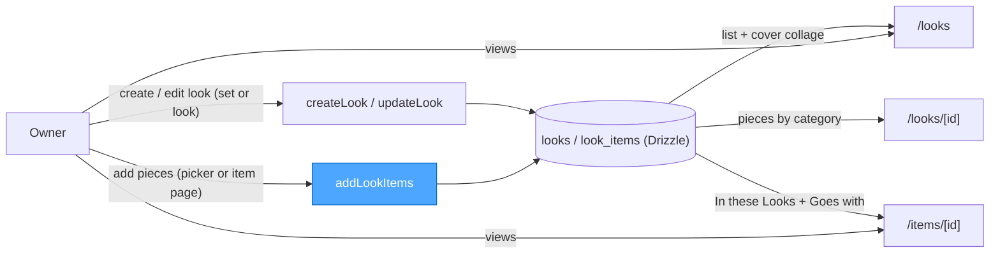

# Looks: Specification Set

> **Set ID:** `SPEC-SET-LOOKS` · **Version:** `0.3.0` · **Status:** DRAFT · **Owner:** nnworkspace

Curated **Looks**: named groups of pieces that go together. Phase 4 (outfits), arriving with a distinction drawn from a real wardrobe: some groups are a genuine **Set** (an intrinsic co-ord), others are a styled **Look** (an assembled combination). Same mechanism, different nature.

## 1. Purpose

A catalog tells you what you *own*; Looks tell you what you *wear together*. It answers the everyday question **"what does this go with?"** (on any piece, see the Looks it belongs to and the pieces it pairs with) **without** the noise of a naive "matching" list (a white shirt would otherwise "match" everything). By keeping Looks **curated**, the answer is always signal: only the combinations you actually chose.

Two natures, one model:
- **Set.** Pieces that *are* a set: a co-ord / matching two-piece you treat as a unit (often the same knit line or bought in one order). Examples already in the wardrobe: the navy jersey top + shorts, the black/white knit top + skirt, the white merino top + skirt.
- **Look.** A *styled combination* you put together from otherwise-independent pieces (e.g. a white shirt + tailored trousers + loafers). The lime-green top + skirt sit between the two: separate products in the same standout colour that the owner wears as a unit.

## 2. Scope

| In scope (v1, curated) | Out of scope (v1) |
|:--|:--|
| **Create / edit / delete** a Look: `name`, `kind` (**set** / **look**), `notes` | **Smart suggestions** ("pieces that might match this") → v2 |
| **Add / remove** pieces (reuse the wardrobe picker) | **Pack a whole Look / Set onto a trip** → v2 (a natural tie-in) |
| **Looks list** (`/looks`) with cover collages + **Looks** nav | Manual ordering of pieces within a Look → v2 |
| **Look detail** (`/looks/[id]`): its pieces, grouped by category | Occasion / season tagging of a Look → v2 |
| **Own photos** per Look (`#98`): upload a shot of the outfit as worn. The cover prefers it, else the piece-collage | Sharing / multi-user |
| **Manual piece order** (`#100`): a flat grid you drag to arrange | Smart / AI-suggested Looks → v2 |
| On a **piece page**: **In these Looks**, **Goes with**, **Add to Look** | Occasion / season tags on a Look → v2 |

## 3. Traceability

| Anchor | Reference |
|:--|:--|
| Data layer (Postgres + Drizzle) | [ADR-0002](../../_governance-local/decisions/ADR-0002-data-layer.md) |
| Photo storage | [docs/ARCHITECTURE.md §5](../../docs/ARCHITECTURE.md#5-photo-storage) |
| Validation (Zod) | [ADR-0006](../../_governance-local/decisions/ADR-0006-validation-library.md) |
| Catalog item model it groups | [`SPEC-CATALOG-DATA`](../catalog/30-data-model-spec.md) |
| Wardrobe picker + cover collage it reuses | [`SPEC-SET-CATALOG`](../catalog/), [`SPEC-SET-TRIPS`](../trips/) |
| This feature's issues | #95 (v0.1.0), #98 (own photos, v0.2.0), #100 (piece ordering, v0.3.0), #170 (archive/delete + reminder, v0.4.0) |

## 4. Specification artefacts

| ID | File | Role |
|:--|:--|:--|
| `SPEC-LOOKS-FUNC` | [10-functional-spec.md](10-functional-spec.md) | Operations, derived views, validation rules |
| `SPEC-LOOKS-INT` | [20-interface-spec.md](20-interface-spec.md) | Routes, UI, Server Actions, flows |
| `SPEC-LOOKS-DATA` | [30-data-model-spec.md](30-data-model-spec.md) | `looks` + `look_items` + `look_photos`; constraints; migration |
| | [manifest.yaml](manifest.yaml) | Inventory |

## 5. Feature context

## 6. How to read this set

1. **This README**: scope and the set/look distinction.
2. **[10-functional-spec.md](10-functional-spec.md)**: what a Look is, the operations, and rules (`VAL-LOOK-*`).
3. **[20-interface-spec.md](20-interface-spec.md)**: the Looks list, the Look page, the per-piece section, and Server Actions.
4. **[30-data-model-spec.md](30-data-model-spec.md)**: the `looks` / `look_items` / `look_photos` tables.

## 7. Roadmap beyond v1

- **v2, smart suggestions:** propose pieces that might match (colour / tags / wear data / photos), and let the AI suggest whole Looks. It reuses the trip-planner stack.
- **v2, Looks × Trips:** add a whole Look or Set to a trip's packing list in one action.
- **Later:** ordering pieces within a Look, occasion/season tags, chosen covers.
