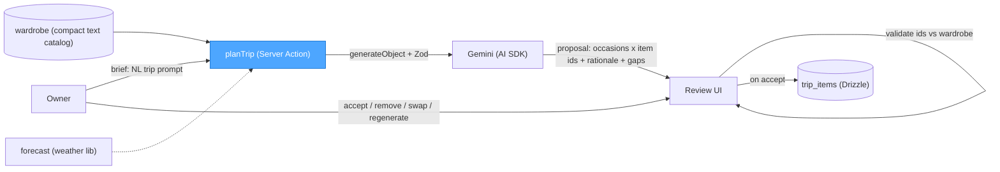

# AI Trip Planner: Specification Set

> **Set ID:** `SPEC-SET-TRIP-PLANNER` · **Version:** `0.1.0` · **Status:** DRAFT · **Owner:** nnworkspace

The **smart** layer on top of manual trips ([`SPEC-SET-TRIPS`](../trips/)): brief the wardrobe in plain language and get a **packing proposal built from real pieces**, grouped by occasion, that the owner edits or regenerates. **V1 is one-shot and human-in-the-loop**: the AI drafts, the owner accepts, and nothing is committed unasked. Chat-refinement and outfits are the next iterations.

## 1. Purpose

Manual trips make a packing list *possible*; this makes it *effortless*. The owner writes, e.g., "3 days / 2 nights in Copenhagen for a client workshop, a formal dinner, and an evening with a friend," and the planner reads the **wardrobe** and the **trip context** (occasions, formality, duration, destination forecast) and proposes actual pieces to pack, with a one-line reason each and a note of any gaps. It turns "what do I own that works?" into "here's a draft. Tweak it."

## 2. Scope

| In scope (v1: one-shot, HITL) | Out of scope (v1) |
|:--|:--|
| A trip **brief** (natural language) + "Plan my trip" | **Multi-turn chat** refinement → next |
| One model call → a **structured proposal**: occasions × chosen wardrobe pieces + rationale + gaps | Persisting per-occasion grouping / **outfits** (Phase 4) |
| **Guardrails:** only real wardrobe item ids (unknowns dropped), no invented pieces | **Photos / visual** matching (text catalog only) |
| **Review + accept**: accept all / per piece, remove, swap, regenerate | Buying/renting to fill gaps; shopping links |
| On accept → picks become `trip_items` (the existing packing list) | Weather-ranked ordering within a category (v0.2 of trips) |
| Reuse the destination **forecast** as an input; **frugal** (one call per generate) | Auto-committing anything without the owner's accept |

## 3. Traceability

| Anchor | Reference |
|:--|:--|
| Planner model / interaction / privacy decision | [ADR-0010](../../_governance-local/decisions/ADR-0010-ai-trip-planner.md) |
| AI stack it reuses (Gemini + AI SDK + `generateObject`) | [ADR-0008](../../_governance-local/decisions/ADR-0008-ai-stack.md) |
| Validation (Zod) | [ADR-0006](../../_governance-local/decisions/ADR-0006-validation-library.md) |
| Trips it builds on (packing list, plan) | [`SPEC-SET-TRIPS`](../trips/) |
| Forecast input | [`SPEC-SET-WEATHER`](../weather/) |
| This feature's issue | #87 |

## 4. Specification artefacts

| ID | File | Role |
|:--|:--|:--|
| `SPEC-PLANNER-FUNC` | [10-functional-spec.md](10-functional-spec.md) | Operations, guardrails, validation rules |
| `SPEC-PLANNER-INT` | [20-interface-spec.md](20-interface-spec.md) | "Plan my trip" panel, the `planTrip` Server Action + model I/O, review UI, flow |
| `SPEC-PLANNER-DATA` | [30-data-model-spec.md](30-data-model-spec.md) | `trips.brief`; the transient proposal shape; how accepts map to `trip_items` |
|  | [manifest.yaml](manifest.yaml) | Inventory |

## 5. Feature context

## 6. How to read this set

1. **This README**: scope and context.
2. **[10-functional-spec.md](10-functional-spec.md)**: what the planner does, its guardrails, and rules (`VAL-PLAN-*`).
3. **[20-interface-spec.md](20-interface-spec.md)**: the "Plan my trip" panel, the `planTrip` Server Action + model I/O, and the review flow.
4. **[30-data-model-spec.md](30-data-model-spec.md)**: `trips.brief`, the transient proposal shape, and how accepted picks land in `trip_items`.

## 7. Roadmap

- **Next, chat refinement:** keep talking to adjust the plan ("Alice's place is casual, so dress it down", "add a raincoat").
- **Next, outfits (Phase 4):** persist the occasion grouping as named outfits, not just a flat list.
- **Later, richer inputs:** photos / visual matching; weather-ranked ordering; learning the owner's packing ratios.
