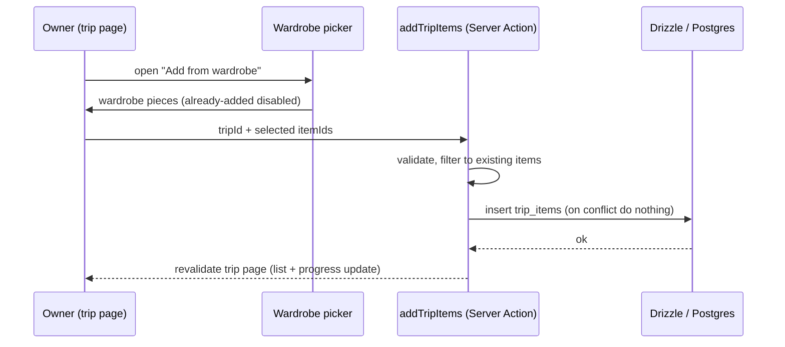
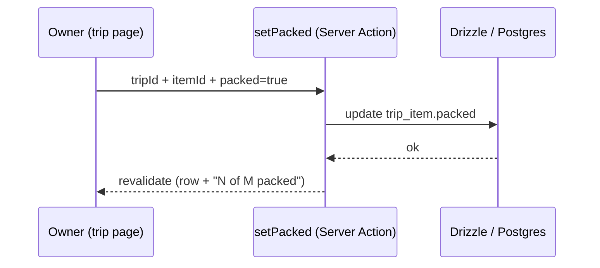
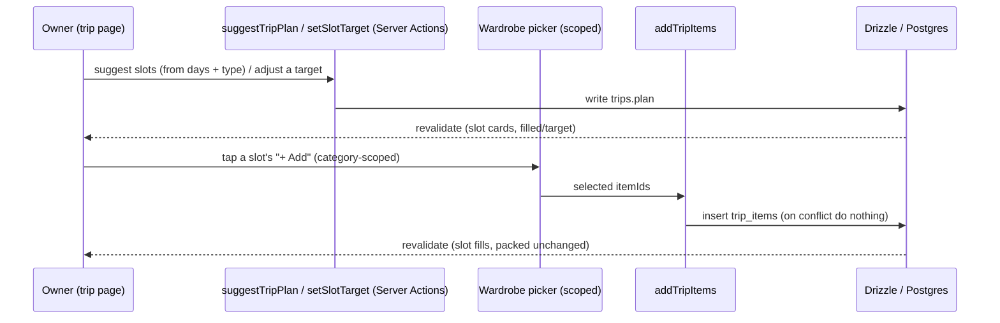

# Trips & Packing — Interface Specification

- **Spec ID:** `SPEC-TRIPS-INT`
- **Part of set:** `SPEC-SET-TRIPS` v0.4.0
- **Traceability:** `SPEC-TRIPS-FUNC` (rules §4); [docs/ARCHITECTURE.md](../../docs/ARCHITECTURE.md); reuses [`SPEC-SET-WEATHER`](../weather/); issue #74

## 1. Purpose and scope

Defines how trips are exposed and wired: the routes, the trips list, the trip detail (packing list), the **two ways to add pieces**, and the Server Actions behind them. Reads run in Server Components; writes are Server Actions (no hand-written API), consistent with the Catalog and Wear-tracking.

## 2. Routes

| Route | Purpose |
|:--|:--|
| `/trips` | Trips list + "New trip" (`OP-TRIP-CREATE`). The header **"Trips"** nav links here. |
| `/trips/[id]` | Trip detail = the packing list (`OP-TRIP-*` for items). |
| `/trips/[id]/edit` | Edit trip details (`OP-TRIP-EDIT`), delete (`OP-TRIP-DELETE`). |
| `/trips/[id]/export` | GET route handler — downloads the packing list as a **Markdown checklist** (`- [ ]` / `- [x]`), grouped by category, with the trip header and plan progress. |
| `/trips/[id]/print` | The packing list **laid out to be printed** (#259) — pieces as a photo grid, grouped by category, each with a checkbox. A **Print / Save as PDF** button opens the browser's print dialogue, whose *Save as PDF* destination is what produces the file. |

### The printable list (#259)

**Why a print stylesheet rather than a generated PDF.** The hard part of this feature is the layout — photo size, what fits on a page, what a checkbox looks like — and a print stylesheet lets that be iterated in a browser in seconds. It also gets the photographs for free: they are `` tags already pointing at Blob. Generating a real PDF server-side would mean fetching and embedding every photo inside one request, which for a thirty-piece trip is thirty image fetches. If one-click download later proves necessary it becomes a rendering change against a layout already agreed, rather than a design argued through a PDF library.

**It has to work in two places at once.** The owner reads it on a phone while packing *and* prints it for the suitcase: two columns on a phone, five on A4.

**The checkbox is drawn, not a control.** The trip page owns packed/unpacked state; this page is a snapshot of it. A box that looked tappable but changed nothing would be worse than one that plainly does not. Pieces already packed print ticked, so the sheet reflects the plan as it stands.

**Print rules that are not optional.** Browsers strip backgrounds and reduce images to save ink, so `print-color-adjust: exact` is load-bearing — a packing list without photographs defeats its purpose. Photos are real `` elements for the same reason. Each card and each category carries `break-inside: avoid`, so a piece is never split and a heading never stranded at the foot of a page.

**Density is a real constraint, measured.** A thirteen-piece trip spread over nine categories ran to 2.6 A4 pages at four columns, most of it whitespace, because each category claims a fresh row. Five columns with a slightly shorter photo brought it to 2.2. The rest is inherent to grouping and was left alone rather than shrinking photographs below the size at which a garment is recognisable — which is the point of the sheet.

`/items/[id]` gains an **"Add to trip"** control (the second add-flow). A non-existent trip id yields a not-found page.

## 3. UI

### 3.1 Trips list (`/trips`)

- A **"New trip"** action opening the trip form (name, type, destination, dates, notes).
- Each trip is a card: **name**, **type** (business / vacation), **destination**, **date range**, **piece count**, and **packed progress** ("N of M packed"), plus **edit** and **delete** controls (#290). Empty state: a short prompt + "New trip".
- **Two tabs, Coming and Past**, side by side above the grid (#292 — stacked sections before that), split on today's date (#290). A trip is Past only once its **end** date has gone by — one you are on right now stays under Coming, because you are still on it and it is still the card you want. An **undated** trip is Coming too, sorted last: a trip with no dates is one not planned yet, not one finished. Within Coming the soonest comes first; within Past the most recent — the same rule, "nearest to today at the top", read from either side. The rule is a pure function of `(trips, today)` in `trip-groups.ts`, so it is testable without freezing the clock.
- **The tab lives in the URL** (`?when=past`), like the category page's `?sub=` — shareable, surviving a refresh, and keeping this page a server component with no client JavaScript. (`PlanModeTabs` uses `router.replace` only because it sits inside a client island.)
- **Both tabs always render, even at zero.** A Past tab that vanished when empty could not be discovered, and *Past 0* is itself an answer. **Coming is always the default**, including when empty — predictable beats clever, and its empty state is the right call to action anyway. With no trips at all, the whole-page empty state shows instead, with no tabs above it.
- **The card's link is *stretched*, not wrapping** (`absolute inset-0`, the #217 pattern from the item card). A card that is one big `<a>` cannot legally contain a button, and edit and delete sit on it. This keeps the whole card clickable, the markup valid, and the link's accessible name the trip's name rather than "name + destination + dates + progress". The controls sit above the link (`z-10`) or the card's own click would swallow them.
- **Delete always confirms**, icon or not (ADR-0015). The dialog names the trip, because on a grid of cards an icon alone does not say which one is about to go.

### 3.2 Trip detail (`/trips/[id]`)

- **Header:** name, type, destination, date range, notes; **Edit** and **Delete** controls; **packed progress** ("N of M packed"), all-packed shown as done.
- **Destination forecast** (when `destination` is set): a compact strip reusing the weather lib (`fetchForecast` / `geocodeCity`, `SPEC-SET-WEATHER`) — **display-only** in v1; absent when there is no destination or the lookup fails (non-blocking).
- **Packing plan** (§3.5): switchable between **by category** — the editable slots — and **by day** (§3.6). When no plan exists yet, a prompt to suggest one.
- **Packing list:** the trip's pieces **grouped by top-level category** (#286 — a shirt dress under Dresses, a bolero under Tops; same order as `TOP_LEVEL_CATEGORIES`). A suitcase of twelve wants to know it holds four dresses, where a wardrobe of 382 wants the precision. Rolling the **primary** up keeps every piece in exactly one group — the duplication risk #259 worried about belongs to *secondary* categories, not to this. The screen, the printable sheet and the Markdown export all go through the one helper (`trip-packing.ts`). **Within a group the order is the trip's own sequence** (#288): by the day a piece is first worn, so a repeat wear sits with its first outing rather than its last; an every-day piece keys on day 1, taking the rule literally rather than inventing a special case; undated pieces come last, by name, because they have no place in the sequence yet and leading with them would hide it. A day outside the trip's current range is ignored, not read as day zero. **A trip with no day plan keeps name order**, unchanged, each row a **cover thumbnail** + name + brand, a **packed** checkbox (`OP-TRIP-SET-PACKED`), and a **remove** (✕) control (`OP-TRIP-REMOVE-ITEM`). The thumbnail/name link to the item.
- **"Add from wardrobe"** opens the picker (§3.4). Empty list: a prompt + the picker.
- Two distinct meters are shown and labelled: **Plan** (slots filled) for planning, **Packed** (N of M) for packing.

### 3.3 Item detail — "Add to trip"

On `/items/[id]`, an **"Add to trip"** control (e.g. a menu): pick an existing trip (or create one) → `addTripItems(tripId, [itemId])`. Idempotent (`VAL-TRIP-05`): adding a piece already on the trip is a no-op with a gentle confirmation.

### 3.4 Wardrobe picker (on the trip page)

A dialog that lists wardrobe pieces (cover thumbnail + name + category) with a **multi-select** and an **Add selected** action → `addTripItems(tripId, itemIds)`. Pieces already on the trip are shown as already-added (disabled), so the picker is safe to reopen. To keep a large wardrobe manageable, the list is **grouped by category** (collapsible sections with counts, in `CATEGORIES` order) and offers the **same filters, search and sort as the Browse view** (#113): a keyword search, a collapsible row of per-facet multi-select dropdowns (occasion / feel / season / care + the style facets + **colour** families + **material** fibres, #299) reusing the shared `FacetDropdown`, and a **sort** dropdown (`SortDropdown` / `sortItems`) — all as **local dialog state** (the picker is a modal, so state is not carried in the URL). Sorting orders the pieces within their category groups.

**Material matches in memory here, where Browse matches in SQL** (#299), through the *same* vocabulary — `MATERIAL_FACETS`, derived from the Compendium's fibre entries (`VAL-BROWSE-18`). The difference is precision, not rule: SQL cannot call the matcher per row and is handed an approximation, while the picker holds the pieces already and uses `containsToken` itself, boundaries and negation guard included. Neither grows its own token list.

It accepts an optional **scope** — a category slug — so a plan slot's **+ Add** (§3.5) opens the picker filtered to just that category (rolled up over its sub-categories). Unscoped, it shows the whole wardrobe grouped. Scoping is the primary lever that turns a 100-piece list into a short, relevant one.

**Two dropdowns, then a flat grid** (#280 → #284 → #296).

```
[ ⌄ All categories ]  [ ⌄ All dresses ]

 ┌────────┐ ┌────────┐ ┌────────┐
 │  card  │ │  card  │ │  card  │ …
```

The picker used to render **every** top-level category at once, each an open disclosure — so choosing a dress meant scrolling past Tops, Trousers and Shoes. That became two rows of chips (#284), and the chips then showed what they cost.

**Height is the scarce resource in this dialog**, which is capped at `88vh`: everything the chooser takes, the pieces lose. Fourteen categories are roughly 1100px of chips — two wrapped rows on a desktop and four or five on a phone, which is where the picker is hardest to use already. A dropdown is one row on both, and matches the `SortDropdown` sitting beside it. The trade is one tap to see the options; worth it at fourteen, and not at four.

- **Category** — "All categories" by default, so opening the picker still shows the whole wardrobe. A category with nothing in it, after the current search and filters, is **not offered**: an option leading to an empty grid is a dead end.
- **Sub-category** — only when the chosen category has children. `All <category>`, one option per child, and `Not categorised` when any piece is filed at the parent with no sub-type. The last is the exact complement of the roll-up, and how a missing sub-type gets noticed.
- **No counts** (#296): they doubled the width of every option for a number that was not being read.
- **The body is a flat grid.** Each card already prints its own category beneath the name.

Choosing a category **clears any sub-choice**: carrying it across would filter Shoes by `slip-dresses` and show an empty grid with no clue why.

Narrowing goes through the shared `categoryMatcher`, so a dress carrying `shirt-dresses` among its **secondary** categories appears under that option while its card still shows its primary.

All of it is local dialog state, reset when the dialog is reopened, like every other picker filter. When the picker is **scoped** (a plan slot's `+ Add`), the category dropdown is hidden — the category is already decided — while the sub-category one still appears if the scope has children.

**A layout note worth keeping.** `DialogContent` uses an explicit `grid-rows` template, so the number of children is load-bearing: #284 added rows without extending it, the chooser inherited the `1fr` track, and with the dialog height-capped it collapsed to its own scrollbar (#294). The chooser therefore lives in one always-present wrapper, since the sub-dropdown renders conditionally. **The component tier cannot catch this** — jsdom reports zero geometry, and every behavioural test passed throughout.

### 3.5 Packing plan (on the trip page)

The plan is a row of **slot cards**, one per `{ category, target }` entry, each showing the category, **filled / target**, and controls:

- a **± handle** to lower/raise the target (`OP-TRIP-PLAN-SET-TARGET` → `setSlotTarget`), and
- a **remove** (✕) to drop the slot (`OP-TRIP-PLAN-REMOVE-SLOT` → `removeSlot`), and
- a **+ Add** that opens the wardrobe picker **scoped to that category** (§3.4).

Above/beside the cards: an **Add slot** control (pick any not-yet-used category → `addSlot`) and, when `plan` is `null`, a **"Suggest slots"** prompt (`suggestTripPlan`; if the trip has no dates, it asks for a day count first). A met slot (`filled ≥ target`) reads as done; the plan overall shows "K of N slots filled". Targets are hints — exceeding one is fine, never blocked (`VAL-TRIP-12`).

### 3.6 The day plan (on the trip page, #270)

A second view of the same pieces, reached by a `By category / By day` tab pair. **Both are kept**: a suitcase is *packed* by category and a trip is *lived* by day, and neither answer replaces the other.

The mode lives in the URL (`?plan=day`), not in component state. Every add is a Server Action round-trip that re-renders the page, and without this the view would snap back to categories on each one.

Each day is a **plain list**, not a set of slots. The owner was explicit — *"make each day's slots simple, do not need to be categorized, simply let me pick pieces to add to the day"* — so there is no target, no fill count and nothing to satisfy. Four kinds of group appear, in this order:

1. **Across all days** — the shoes, the blazer, the earrings: things that serve the whole trip and would be silly to file under a date.
2. **One group per day**, *including the empty ones*. An empty Thursday is the most useful thing this view can tell you, so on screen it is shown; on paper it is dropped, because a blank group is wasted sheet.
3. **Not scheduled yet** — packed, but not yet placed. Every piece in every trip that predates this feature starts here, so it has to be visible or they vanish without being gone.
4. **Planned for a day this trip no longer has** — see `SPEC-TRIPS-DATA` §3.1. Shown, labelled, and clearable on request.

Each row links to the piece and carries a ✕ that removes it **from that group only** — never from the trip. A day's **Add** opens the ordinary wardrobe picker (§3.4) carrying the day with it; pieces already on the trip are **not** marked as added there, because a piece already packed can still be planned for another day.

When the trip has no days to show, the view says **which** of the three reasons applies — no dates, end before start, or longer than 60 days — and links to the edit form. An empty frame that silently wants something is worse than a sentence.

**The packing list keeps its category grouping** and gains a day label per row ("Mon, Wed", or "every day"). That is the point of `VAL-TRIP-13`: the planner may show a piece four times, the list shows it once, because the list is what goes in the case.

### 3.7 The printable sheet, by day (#270)

`/trips/[id]/print?by=day` groups the same photo grid by day instead of by category, with a link between the two sheets. By category stays the default — it is how a case is packed. The category plan strip is omitted on the by-day sheet, where per-category targets mean nothing. The Markdown export carries both: a **By day** section, then the packing list with its day labels.

## 4. Server Actions

| Action | Input | Result |
|:--|:--|:--|
| `createTrip(formData)` | name, type, destination?, start/end?, notes? | inserts a `trip`; redirect to `/trips/[id]`; or `{ errors }` |
| `assignToDay(formData)` | tripId, day, itemIds | plans pieces for a day; adds them to the trip first if needed; rejects a day outside the range (#270) |
| `unassignFromDay(formData)` | tripId, itemId, day | removes one day assignment; the piece stays packed |
| `setEveryDay(formData)` | tripId, itemId, everyDay | moves a piece into/out of *across all days*; turning it on clears its days |
| `addToEveryDay(formData)` | tripId, itemIds | the picker's route into *across all days* |
| `clearOrphanedDays(formData)` | tripId | drops assignments outside the current range; the pieces stay packed |
| `updateTrip(id, formData)` | same fields | updates the `trip`; redirect to `/trips/[id]`; or `{ errors }` |
| `deleteTrip(formData)` | trip id | deletes the trip (cascades `trip_items`); redirect to `/trips` |
| `addTripItems(formData)` | trip id + item id(s) | inserts `trip_item`(s), `packed=false`, **on-conflict-do-nothing** (`VAL-TRIP-05`); revalidates the trip |
| `removeTripItem(formData)` | trip id + item id | deletes that `trip_item`; revalidates |
| `setPacked(formData)` | trip id + item id + packed | sets `trip_item.packed`; revalidates |
| `suggestTripPlan(formData)` | trip id (+ day count if no dates) | computes default slots from length + type and **replaces** `plan` (`VAL-TRIP-11`); revalidates |
| `setSlotTarget(formData)` | trip id + category + target | sets that slot's target 0–99, adding the slot if absent (`VAL-TRIP-10/11`); revalidates |
| `addSlot(formData)` | trip id + category | adds a slot (default target 1) if not present; revalidates |
| `removeSlot(formData)` | trip id + category | removes that slot from `plan`; revalidates |

The four plan actions read-modify-write the trip's `plan` JSONB (a short array) and never touch `trip_items`. All actions validate with Zod (ADR-0006) against `VAL-TRIP-*` before writing, and revalidate `/trips` and/or `/trips/[id]`.

## 5. Flows

### 5.1 Add from wardrobe — `STEP-TRIP-ADD-*`



- `STEP-TRIP-ADD-01` open picker → `02` multi-select → `03` add → `04` insert (idempotent) → `05` pieces appear unpacked, progress updates.

### 5.2 Pack a piece — `STEP-TRIP-PACK-*`



### 5.3 Fill a plan slot — `STEP-TRIP-PLAN-*`



- `STEP-TRIP-PLAN-01` suggest/adjust slots → `02` tap a slot's + Add → `03` scoped picker → `04` add pieces → `05` the slot's "filled" rises toward its target.

## 6. UI states

- **No trips:** `/trips` shows a prompt + "New trip".
- **Empty packing list:** the trip page shows a prompt + "Add from wardrobe".
- **No plan yet (`plan = null`):** the plan section shows a "Suggest slots" prompt (asking for a day count when the trip has no dates).
- **Emptied plan (`plan = []`):** the plan section offers to add a slot or re-suggest.
- **Plan complete:** every slot met (`filled ≥ target`) reads as done.
- **All packed:** the progress reads complete (e.g. a "Packed ✓" state) when N = M > 0.
- **No destination / forecast unavailable:** the forecast strip is simply absent — never blocks the page.
- **Error:** a validation message on the offending field; the page/form stays usable.
- Trips are additive — the catalog works exactly as before without ever creating one.
