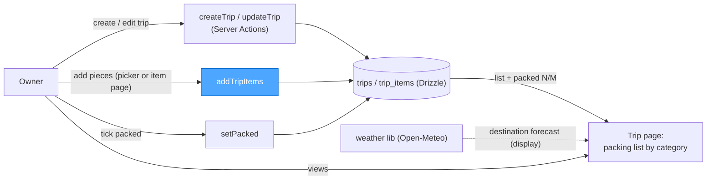

# Trips & Packing: Specification Set

> **Set ID:** `SPEC-SET-TRIPS` · **Version:** `0.2.0` · **Status:** DRAFT · **Owner:** nnworkspace

Phase 3 from the roadmap: create a **trip** (business or vacation) and build a **packing list** from the wardrobe, and mark pieces packed as you go. **V1 is manual**: the owner curates the list; the app tracks what's packed. **V1.1** adds a soft, editable **packing plan** of per-category slots with suggested target counts from trip length + type, each opening the picker scoped to that category (still manual: slots guide, never auto-add). **Smart ranking** within a slot and **weather-aware packing** are the planned next iteration (v0.2): designed-for here, not built yet.

## 1. Purpose

A wardrobe earns its keep when it helps you leave the house, and the trip is where a catalog becomes a tool. Trips turn "what do I own?" into "what am I taking?": pick pieces onto a trip, see them grouped by category, and tick them off as they go in the bag. It reuses everything Phase 1–2 built (items, photos, categories, tags) and the destination sets up the weather tie-in the header widget already proves out.

## 2. Scope

| In scope (v1: manual) | Out of scope (v1) |
|:--|:--|
| **Create / edit / delete** a trip (name, type, destination, dates, notes) | **Smart suggestions** (trip type / length / season / wear data) → v0.2 |
| **Trips list** (`/trips`) + **trip detail** (`/trips/[id]`) | **Weather-aware packing** (destination forecast → picks) → v0.2 |
| **Packing list**: pieces grouped by category, cover thumbnail, **packed** toggle, progress N/M | Outfits linkage (Phase 4) |
| **Add pieces two ways**: a wardrobe **picker** on the trip page (grouped by category, tag-filterable), and **"Add to trip"** on an item page | **Ranking pieces within a slot** (favourite / weather / least-worn) → v0.2 |
| **Packing plan (v1.1)**: editable per-category **slots** with suggested targets (from days + type); each opens the picker scoped to that category | Sharing / multi-user / collaborative packing |
| **Packing plan (v1.2, #270)**: the same pieces seen **by day** (a plain list per date plus an *Across all days* group), switchable with the category view. A piece may be planned for any number of days and stays one packed piece | **Suggesting which piece goes on which day**: the owner places them by hand, by request |
| **Remove** a piece from a trip | Trip templates, recurring trips, checklists beyond wardrobe items |
| **Destination forecast** on the trip page (display-only, reuses the weather lib) | Notifications / reminders |
| **Taking the list off the screen**: a Markdown checklist export, and a **printable sheet** (#259), pieces as a photo grid with a box to tick, printed or saved as a PDF through the browser's own dialogue | A server-generated PDF; see `SPEC-TRIPS-INT` for why the print stylesheet was chosen |

## 3. Traceability

| Anchor | Reference |
|:--|:--|
| Data layer (Postgres + Drizzle) | [ADR-0002](../../_governance-local/decisions/ADR-0002-data-layer.md) |
| Validation (Zod) | [ADR-0006](../../_governance-local/decisions/ADR-0006-validation-library.md) |
| Catalog item model it draws on | [`SPEC-CATALOG-DATA`](../catalog/30-data-model-spec.md) |
| Weather lib reused for the forecast | [`SPEC-SET-WEATHER`](../weather/) |
| This feature's issue | #74 |

## 4. Specification artefacts

| ID | File | Role |
|:--|:--|:--|
| `SPEC-TRIPS-FUNC` | [10-functional-spec.md](10-functional-spec.md) | Operations, derived stats, validation rules |
| `SPEC-TRIPS-INT` | [20-interface-spec.md](20-interface-spec.md) | Routes, UI, Server Actions, flows |
| `SPEC-TRIPS-DATA` | [30-data-model-spec.md](30-data-model-spec.md) | `trips` + `trip_items`; constraints; migration |
|  | [manifest.yaml](manifest.yaml) | Inventory |

## 5. Feature context

## 6. How to read this set

1. **This README** for scope and context.
2. **[10-functional-spec.md](10-functional-spec.md)**: operations, packed progress, rules (`VAL-TRIP-*`).
3. **[20-interface-spec.md](20-interface-spec.md)**: the trips list, trip page, the two add-flows, and Server Actions.
4. **[30-data-model-spec.md](30-data-model-spec.md)**: the `trips` / `trip_items` tables and constraints.

## 7. Roadmap beyond v1

- **v0.2, smart suggestions:** propose pieces from trip type/length, season, and wear data (leans on Phase-2 tags + wear-tracking stats).
- **v0.2, weather-aware packing:** bias suggestions to the destination's 10-day forecast (the trip's `destination` already feeds the weather lib).
- **Phase 4, outfits:** pack named outfits, not just individual pieces.
