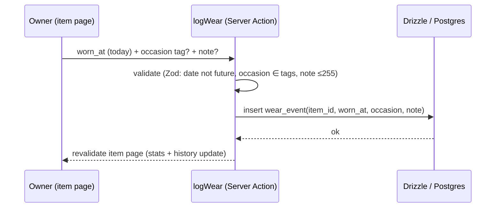
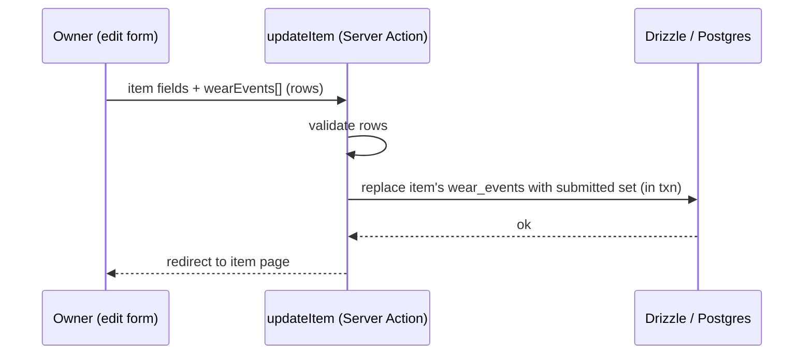

# Wear Tracking: Interface Specification

- **Spec ID:** `SPEC-WEAR-INT`
- **Part of set:** `SPEC-SET-WEAR` v0.1.0
- **Traceability:** `SPEC-WEAR-FUNC` (rules §4); [docs/ARCHITECTURE.md](../../docs/ARCHITECTURE.md); issue #42

## 1. Purpose and scope

Defines how wear tracking is exposed and wired: the wear summary + history + quick-log on the item detail page, the editable wear rows in the edit form, and the Server Actions behind them. Reads run in Server Components; writes are Server Actions (no hand-written API), consistent with the Catalog.

## 2. UI

### 2.1 Item detail page

A **"Worn"** block, below the item's details:

- **Summary line**: "Worn **N** times · Last worn **{date}** · **{cost}/wear**". The cost segment appears only when price paid is set and N > 0 (`VAL-WEAR-05`); when N = 0, the block reads "Not worn yet."
- **History**: the wears, most recent first. Each row is **read-only** (`worn_at` · occasion · note) with an **Edit** (pencil) and a **remove** (✕) control. Clicking **Edit** turns the row's date, occasion selector, and note into editable fields with **Save** / **Cancel**; Save calls `updateWear` (`OP-EDIT-WEAR`), remove calls `removeWear` (`OP-REMOVE-WEAR`).
- **Quick "Log a wear"**: a compact inline form with, left to right, a **date** input (`defaultValue` = today, `max` = today), an **occasion tag** selector (the occasion vocabulary + a "none" option, `VAL-WEAR-06`), a free-text **note** input (`VAL-WEAR-03`), and a **Log** button (`OP-LOG-WEAR`).

### 2.2 Edit form

A **"Wear log"** section (mirroring the existing "details" repeatable rows): each row is a **date** input + an **occasion tag** selector + a **note** input, with add/remove. A hidden field carries the rows as JSON; on submit `updateItem` **reconciles** the item's wears to these rows (`VAL-WEAR-07`).

## 3. Server Actions

| Action | Input | Result |
|:--|:--|:--|
| `logWear(itemId, formData)` | `worn_at`, optional `occasion` | inserts one `wear_event`, revalidates the item page; or `{ error }` |
| `updateWear(formData)` | a `wear_event` id (+ item id, date, occasion, note) | updates that wear's occasion / note inline, revalidates (`OP-EDIT-WEAR`) |
| `removeWear(formData)` | a `wear_event` id (+ item id) | deletes that wear, revalidates; or `{ error }` |
| `updateItem(...)` | existing form + `wearEvents` JSON | as today, plus **reconciles** the item's wears to the submitted rows |

All validate with Zod (ADR-0006) against the `VAL-WEAR-*` rules before writing, run inside the item's ownership (a wear must reference an existing item), and revalidate `/items/[id]`.

## 4. Occasion tag & note

The **occasion** is a native `<select>` populated from the **occasion** `TAG_GROUP` (`casual / office / occasion / sport / loungewear`) plus a "none" option. It is a structured tag, validated server-side (`VAL-WEAR-06`). The specific detail (e.g. "quarterly review meeting") goes in the separate free-text **`note`** field. No new vocabulary is introduced.

## 5. Flows

### 5.1 Quick log: `STEP-WEAR-LOG-*`

- `STEP-WEAR-LOG-01` open item → `02` pick date/occasion → `03` validate → `04` insert → `05` page shows updated count / last-worn / cost-per-wear.

### 5.2 Edit-form reconcile: `STEP-WEAR-EDIT-*`

- `STEP-WEAR-EDIT-01` edit rows → `02` save → `03` validate → `04` reconcile in the same transaction as the item update → `05` item page reflects the list.

## 6. UI states

- **No wears:** "Not worn yet" + the quick-log control.
- **Has wears:** summary line (with cost-per-wear when priced) + history + quick-log.
- **Error:** a validation message on the offending field; the page/form stays usable.
- Wear tracking is additive: an item works exactly as before without ever logging a wear.
