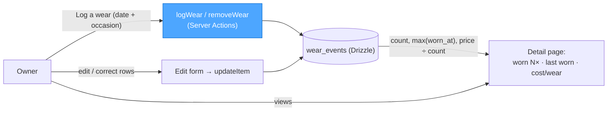

# Wear Tracking: Specification Set

> **Set ID:** `SPEC-SET-WEAR` · **Version:** `0.1.0` · **Status:** DRAFT · **Owner:** nnworkspace

A catalog enhancement (from the roadmap's *wear tracking* backlog): log each time a piece is worn (a **date** and an optional **occasion**) and see **how many times** it's been worn, **when last**, and its **cost-per-wear**. Two ways to log: a quick action on the item page and editable rows in the edit form.

## 1. Purpose

A wardrobe is more useful when it knows what you actually wear. Logging wears turns the catalog into a record you can act on: which pieces earn their keep (cost-per-wear), which you've neglected, and, later, what to pack for a trip. This set adds the wear log to the existing item; it introduces one new table and no new screens beyond the item's own detail and edit views.

## 2. Scope

| In scope | Out of scope |
|:--|:--|
| Log a wear = **date + optional occasion**, many per item | Auto-detecting wears (no tracking/inference) |
| **Quick "Log a wear"** on the item detail page (date defaults to today) | Wear reminders / notifications |
| **Editable wear rows** in the edit form (add / remove / correct) | Analytics dashboards, charts, trends |
| Derived stats: **worn N times**, **last worn**, **cost-per-wear** | Per-outfit wear (that's Phase 4) |
| **Occasion** = free text with occasion-tag suggestions | Sharing / multi-user |

## 3. Traceability

| Anchor | Reference |
|:--|:--|
| Data layer (Postgres + Drizzle) | [ADR-0002](../../_governance-local/decisions/ADR-0002-data-layer.md) |
| Validation (Zod) | [ADR-0006](../../_governance-local/decisions/ADR-0006-validation-library.md) |
| Catalog item model it extends | [`SPEC-CATALOG-DATA`](../catalog/30-data-model-spec.md) |
| This feature's issue | #42 |

## 4. Specification artefacts

| ID | File | Role |
|:--|:--|:--|
| `SPEC-WEAR-FUNC` | [10-functional-spec.md](10-functional-spec.md) | Operations, derived stats, validation rules |
| `SPEC-WEAR-INT` | [20-interface-spec.md](20-interface-spec.md) | UI (detail + edit), Server Actions, flows |
| `SPEC-WEAR-DATA` | [30-data-model-spec.md](30-data-model-spec.md) | The `wear_events` table; derived stats; dropped columns |
|  | [manifest.yaml](manifest.yaml) | Inventory |

Unlike Browse/AI-import, this feature **does** add data, hence a `30-data-model` spec.

## 5. Feature context

## 6. How to read this set

1. **This README** for scope and context.
2. **[10-functional-spec.md](10-functional-spec.md)**: operations, stats, rules (`VAL-WEAR-*`).
3. **[20-interface-spec.md](20-interface-spec.md)**: the detail-page control, edit-form rows, and Server Actions.
4. **[30-data-model-spec.md](30-data-model-spec.md)**: the `wear_events` table and derived stats.
