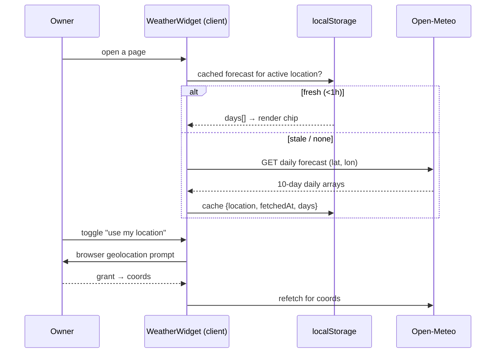

# Weather Strip — Interface Specification

- **Spec ID:** `SPEC-WEATHER-INT`
- **Part of set:** `SPEC-SET-WEATHER` v0.1.0
- **Traceability:** `SPEC-WEATHER-FUNC` (rules §4); [docs/ARCHITECTURE.md](../../docs/ARCHITECTURE.md); issue #43

## 1. Purpose and scope

Defines how the widget is exposed and wired: the header UI, the Open-Meteo request, geolocation, and client-side caching. Unlike the rest of the app (server-first), this widget is **client-side** — because geolocation is browser-only and Open-Meteo is keyless + CORS-enabled, so a direct client fetch exposes no secret.

## 2. UI

A **`WeatherWidget`** client component, rendered **twice** in the header (`SiteHeader`, near the theme toggle): `kind="home"` and `kind="travel"`.

- **Compact chip** (each): a **home / plane** marker + today's condition icon + high temp, e.g. `🏠 ☀ 24°`, with a caret hinting it expands.
- **Popover** (on click): a header row with the location name and a location control —
  - **home**: a *Use my location* ↔ *Home* toggle;
  - **travel**: a *change-city* input (typed name → geocoded) plus a *Reset*.

  Then **10 rows** — `weekday · date (YYYY-MM-DD) · condition icon · high° / low°`. Closes on outside click / Esc.
- **States:** *loading* (renders nothing until data), *ready*, *unavailable* (renders nothing, `VAL-WEATHER-04`), *geolocation denied* / *city not found* (a one-line note).

## 3. Data source & flow

- **Provider:** Open-Meteo daily forecast:
  `GET https://api.open-meteo.com/v1/forecast?latitude={lat}&longitude={lon}&daily=weathercode,temperature_2m_max,temperature_2m_min&forecast_days=10&timezone=auto`
- **Fetch:** client-side on mount; parse the parallel `daily.time[] / weathercode[] / temperature_2m_max[] / _min[]` arrays into ten `{ date, code, hi, lo }`.
- **Cache:** store `{ location, fetchedAt, days[] }` in `localStorage` keyed by rounded coords; reuse when `< 1h` old (`VAL-WEATHER-03`), else refetch (showing the cached value meanwhile).
- **Location (per chip, persisted in `localStorage`):**
  - **Home**: default `HOME_LOCATION` (**Berlin**, 52.5200, 13.4050); optional `navigator.geolocation.getCurrentPosition` on the explicit toggle only (`VAL-WEATHER-02`).
  - **Travel**: default `TRAVEL_DEFAULT` (**Vienna**); changeable by typing a city, resolved via Open-Meteo **geocoding** — `GET https://geocoding-api.open-meteo.com/v1/search?name={city}&count=1` → `{ name, lat, lon }`.
  - Both defaults are keyless config constants in `src/lib/weather.ts` (`VAL-WEATHER-06`).

## 4. Condition icons

A pure `codeToCondition(code)` helper (in `src/lib/weather.ts`) maps the WMO `weathercode` to `{ label, Icon }` per `SPEC-WEATHER-FUNC` §3, using `lucide-react` icons already in the app. Unknown codes → "cloudy".

## 5. Integration notes

- The widget is **additive** — the header and every page work unchanged if weather is unavailable.
- No server route, no API key, no environment secret (Open-Meteo is keyless). Only latitude/longitude leave the browser, and only to Open-Meteo (`VAL-WEATHER-01`).
- Requests are bounded by the ~1h cache; opening many pages in an hour makes at most one call per location.
