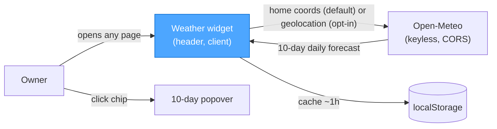

# Weather Strip — Specification Set

> **Set ID:** `SPEC-SET-WEATHER` · **Version:** `0.1.0` · **Status:** DRAFT · **Owner:** nnworkspace

Two compact **10-day forecast** chips in the header — each a "today" chip that expands to the full ten days — to help decide what to wear: **🏠 home** (Berlin; with an opt-in "use my location" switch) and **✈ travel** (a destination, default Vienna, changeable by typing a city). Also a stepping stone to Phase 3's weather-aware packing.

## 1. Purpose

A wardrobe app is more useful when it knows the weather. This adds an at-a-glance forecast so the owner can see, on opening the app, whether the next days call for linen or knitwear — min/max temperature and a simple condition (clear / cloudy / rain / snow / …) per day.

## 2. Scope

| In scope | Out of scope |
|:--|:--|
| Two compact **header** chips (home + travel): today's condition + high temp | Hourly forecasts, precipitation %, wind, UV |
| Expandable **10-day** popover per chip (per day: weekday · date · condition · high/low) | Historical weather, alerts/warnings |
| **Home** (Berlin) with opt-in **geolocation**; **travel** destination changeable by **city name** | More than two locations; saved trips (Phase 3) |
| **Open-Meteo** forecast + **geocoding** (free, keyless), client-side, ~1h cache | Outfit suggestions from weather (later) |
| Graceful degradation when unavailable | A settings UI to edit the home default (a later enhancement) |

## 3. Traceability

| Anchor | Reference |
|:--|:--|
| Stack | [ADR-0001](../../_governance-local/decisions/ADR-0001-tech-stack.md) |
| Free-tier / keyless posture (as with the AI stack) | [ADR-0008](../../_governance-local/decisions/ADR-0008-ai-stack.md) |
| This feature's issue | #43 |

**Provider:** [Open-Meteo](https://open-meteo.com) — free, **no API key**, CORS-enabled (so a client-side fetch exposes no secret), generous limits. Daily fields: `weathercode`, `temperature_2m_max`, `temperature_2m_min`. Chosen for the same $0/keyless reasons as the AI stack; a low-stakes integration (could be recorded as an ADR if we prefer).

## 4. Specification artefacts

| ID | File | Role |
|:--|:--|:--|
| `SPEC-WEATHER-FUNC` | [10-functional-spec.md](10-functional-spec.md) | Operations, condition mapping, rules |
| `SPEC-WEATHER-INT` | [20-interface-spec.md](20-interface-spec.md) | Header widget, Open-Meteo integration, geolocation |
| — | [manifest.yaml](manifest.yaml) | Inventory |

No `30-data-model` — nothing is persisted server-side. The chosen location/mode and a short-lived forecast cache live in the browser (`localStorage`).

## 5. Feature context

## 6. How to read this set

1. **This README** for scope and context.
2. **[10-functional-spec.md](10-functional-spec.md)** — what it shows and the rules (`VAL-WEATHER-*`).
3. **[20-interface-spec.md](20-interface-spec.md)** — the header widget, Open-Meteo call, and geolocation.
